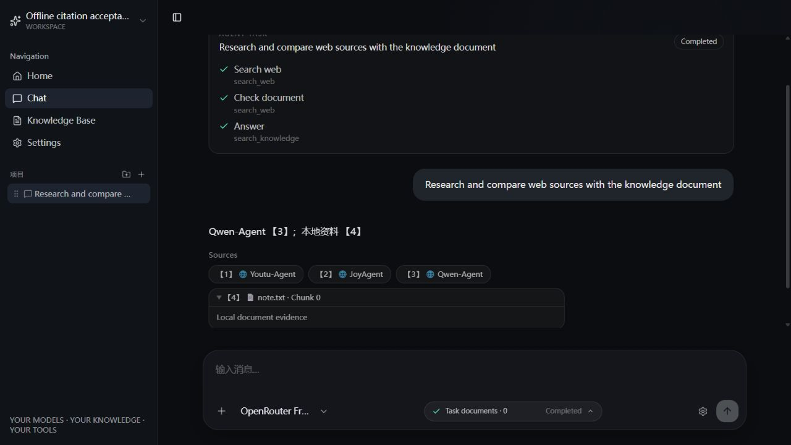

# 引用编号与 SSE 验收 — 2026-10-13

## 结果与边界

本轮完成引用绑定修复、实际 HTTP SSE 验证和实际浏览器展示验证。浏览器操作的对象是项目原有 Vue 页面，连接原有 FastAPI 路由；专项回放服务的模型、Web 搜索和知识检索使用确定性测试替身，并禁止真实 Exa 请求。新增真实 LLM 请求 **0**。这不等于完成真实 Exa + 真实 LLM 的端到端验收。

**额度审计更正：**早期执行全套 pytest 时，旧的 `test_tool_call_saves_accumulated_usage` 未 Mock 搜索。最后审查时用拦截 `httpx.post` 的单项审计确认，该测试会尝试 1 次真实搜索。此前共运行过 4 次全套测试，因此可能发起过 4 次 Exa 请求；没有保留当时的响应日志，无法确定成功次数、实际额度消耗或账单。早期口头报告“本轮新增 Exa 请求为 0”不成立。已补齐该测试的 Mock，并增加默认 HTTPTransport/AsyncHTTPTransport 网络拦截；即使业务代码捕获了拦截错误，测试 teardown 也会失败。专项 HTTP/浏览器回放服务不受这个旧测试缺口影响。

最终后端：**124 passed、62 subtests passed**；前端 `vue-tsc -b` 与 Vite production build 通过。实际 loopback TCP/HTTP 的六个场景全部通过。

## 开始时核实的状态

- 仓库：`D:\github\ai-chat-app-main`；当前聊天原工作目录 `D:\Attendance` 是另一工程。
- 分支：`feat/agent-core`；HEAD：`f14e83eb069d039e043d6b48b1c40895ec661381`。
- 已存在 7 个修改文件以及未跟踪 `backend/app/services/citations.py`。本轮在此基础上续接，没有清理、重置或覆盖为旧版本。
- 8000 / 5173 端口最初均未监听；旧临时验收报告确实存在并已读取。
- 本地配置检查仅输出 `SEARCH_PROVIDER=exa`、`EXA_API_KEY_configured=True`，没有输出密钥。
- 接手后的基线测试为 113 通过、1 失败：旧 RAG 测试使用 `[1]`，与未完成的新标记协议不兼容。

## 根因与最终调用链

旧实现中，工具结果生成独立的 `CitationSource` 列表，模型自行选择正文编号；前端按列表顺序显示来源。二者没有正式绑定。因此，模型将搜索结果中的第 3 条 Qwen-Agent 自行写为第 2 个引用时，正文与 Sources 发生错位。

当前链路如下：

1. Web 工具结果或 RAG chunks 转为 `CitationSource`。
2. 请求内的 `CitationRegistry.add()` 按 Web URL 或文档 chunk 身份去重，顺序分配 `citation_id`；重复调用不会改变已分配编号。
3. `CitationRegistry.prompt()` 将来源信息与确定的 `[[cite:...]]` 标记交给模型。Agent 的普通、修复、最终回答和预算停止后的总结路径均收到目录。
4. `CitationStream.feed()` 缓冲跨增量的标记，核对存在性后才发出 `【n】`；未知、畸形、自编数字和未闭合标记触发明确错误，不发出错误标记、不保存该失败回答。普通文字继续流式发送；反引号/波浪线代码块、行内代码和转义括号有回归覆盖。
5. SSE 的 `source` 事件先于正文引用发送，并携带 `citation_id`。Agent 与普通聊天共用相同绑定规则，前端也按 ID 去重。
6. `MessageBubble.vue` 显示来源可见编号；Web 来源继续使用工具实际返回的 URL，知识来源保留可展开的 chunk 预览。
7. `save_chat_turn()` 将转换后的正文和 `sources_json` 一起保存；历史接口返回 Sources，前端刷新时恢复。SQLite 与 PostgreSQL 的增量列迁移保留旧记录，旧记录默认为空来源。

没有新增运行时依赖，没有扩大 Agent/RAG 的职责范围。ponytail 与 token-saver 技能用于沿用已有接口、缩小改动和验证范围；computer-use 用于实际浏览器验收。

## 验收证据

| 验收项 | 方式 | 结果 |
| --- | --- | --- |
| 单来源、多个来源、重复 URL、多工具调用、Web/知识来源混合 | 确定性回归 | 通过；Qwen-Agent 为 3，知识 chunk 为 4 |
| 标记的每一个切分位置、逐字符增量 | 确定性回归 | 通过；标记完整验证前不暴露给前端 |
| 自编 `[3]` / `【2】`、不存在 `[999]`、未知标记、未闭合标记 | 回归与 HTTP | 明确失败；错误标记未显示，未保存失败回答 |
| 非流式 `/chat` 与非流式 Agent | ASGI HTTP 回归 | 通过；同一目录和显示编号 |
| 引用缓冲期间关闭生成器 | 回归 | Provider 关闭；不保存半截正文 |
| 旧 SQLite 消息迁移 | 临时数据库回归 | 原文不变，Sources 默认为空 |
| 实际 HTTP 普通聊天 | 本机 TCP/HTTP + 回放 | 200、正确 Content-Type、20 个 SSE 事件、done、持久化一致 |
| 实际 HTTP Agent | 本机 TCP/HTTP + 回放 | 200、51 个 SSE 事件、Completed、done、正文与来源恢复一致 |
| 实际 HTTP 非法引用 | 本机 TCP/HTTP + 回放 | 41 个事件；error，无 done，无聊天记录 |
| 实际 HTTP Provider 断流 | 本机 TCP/HTTP + 故障注入 | 50 个事件；error，无 done，无聊天记录 |
| 实际 HTTP Agent 取消 | 本机 TCP/HTTP + cancel endpoint | 29 个事件；Cancelled，无 done，无聊天记录 |
| 实际 HTTP 客户端主动关闭连接 | 本机 TCP/HTTP | 收到 5 个事件后关闭；无半截聊天记录 |
| 真实浏览器成功路径 | 原 Vue 页面 + 回放后端 | Agent Completed；正文 `Qwen-Agent【3】`，Sources 第 3 条为 Qwen-Agent |
| 浏览器 Web 来源点击 | 实际点击链接 | 新标签打开 `https://github.com/QwenLM/Qwen-Agent/blob/31a4d36d/README_CN.md` |
| 浏览器知识来源 | 实际展开 | `【4】note.txt · Chunk 0`，显示 `Local document evidence` |
| 浏览器刷新恢复 | 实际 reload | 正文、编号、URL、知识来源恢复一致 |
| 浏览器非法引用 | 故障注入 | Failed 与错误提示可见；`[999]` 未显示 |
| 浏览器停止生成 | 实际点击按钮 | Cancelled 与半截回答提示可见 |
| 浏览器 Provider 失败 | 故障注入 | Failed 与错误提示可见；已经显示的有效引用仍有 Sources |
| 浏览器控制台 | 工具读取 error/warn | 本轮验收页面未发现异常 |

正常渲染截图：



其他证据：[取消截图](citations-cancel-2026-10-13.png)、[失败截图](citations-failure-2026-10-13.png)。

## 复现

在 `backend` 目录执行：

```powershell
.\.venv\Scripts\python.exe -m pytest
.\.venv\Scripts\python.exe -m scripts.serve_citation_replay
```

另开终端，在 `backend` 目录执行实际 HTTP 验证：

```powershell
.\.venv\Scripts\python.exe -m scripts.serve_citation_replay --check
```

在 `frontend` 目录执行：

```powershell
npm.cmd run build
npm.cmd run dev -- --host 127.0.0.1
```

打开 `http://127.0.0.1:5173/chat`。输入 `Research and compare web sources with the knowledge document`，核对 3/4 编号、来源点击和刷新。末尾增加 `invalid`、`disconnect`、`slow` 分别测试非法编号、Provider 失败、可取消的慢速流。

回放服务使用独立临时 SQLite/storage/Chroma 路径，并禁止真实 Exa；不修改 `.env` 或用户业务数据。该服务仅用于验收，不应当当作正常产品后端使用。复现前需要保证 8000 / 5173 端口空闲。

## 未验证与交付状态

- 未新增真实模型调用，尚未验证现有免费模型对新标记协议的遵循率；不遵循时会明确失败，本轮没有自动付费重试或降级。
- 注册表保证标记、可见编号、Sources URL 的结构映射；它不能证明模型陈述的事实正确，也不能判断模型是否选错一个真实存在的来源。正文中的一般超链接不由本次标记解析器统一审查；Sources 的 URL 来自工具结果，不接受模型自行创建来源。
- 知识检索使用测试替身，未重新运行真实 embedding/Chroma 检索；数据库持久化、旧记录迁移已用 SQLite 验证，未对用户 PostgreSQL 实例执行实际迁移验收。
- 历史旧记录没有保存过的 Sources 无法凭空补回；本轮不改写旧正文。
- pytest 有 1 条现有 Starlette/anyio 弃用警告；Vite 有大 chunk 警告，均不阻止检查通过。
- 已关闭本轮启动的临时回放后端与 Vite 服务；启动前这两个端口没有服务。验收脚本与截图保留供复现。
- 改动保留在本地工作区；未创建 commit、未 push、未触发新的 GitHub CI；未修改/合并 `main`。
