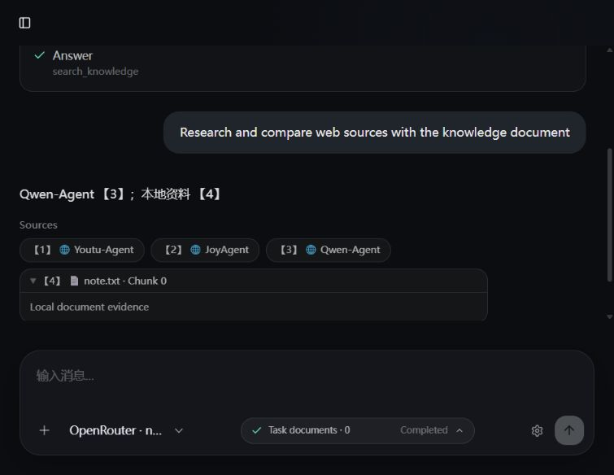

# Citation 修复续验收 — 2026-10-20

本报告更新 10 月 13/14 日的历史验收结论；那些报告里的“未提交”“待修复数组”是当时状态。

## 根因与修复

原实现让模型自行编号，再独立按工具返回顺序显示 Sources，没有正文与来源的绑定协议。

- 请求内 CitationRegistry 按真实 Web URL / 文档 chunk 身份去重，分配不变的 citation_id。
- 模型收到包含来源身份、URL、编号和确定性 marker 的目录。模型复制 marker，服务端转换为【n】。
- CitationStream 在发 SSE message 前缓冲并验证跨片段 marker。未知、畸形、未闭合 marker 以及自编的引用编号触发错误，不保存失败回答。
- Sources 事件先于对应正文发出；前端按同一 citation_id 显示和去重。转换后的正文与 sources_json 一起原子保存，刷新恢复。
- 普通 Chat、同步 /chat、Agent 的最终和预算停止回答共用上述机制。
- 修复 10 月 14 日审查发现的普通数组误拦截：ASCII 数字列表/范围视为普通数据；无来源时 [1] 也作为普通数据保留。已有来源时单独 [n]、以及全角【n】视为未绑定引用并拒绝。有效引用只能使用目录 marker。这是确定性语法规则，不是对自然语言引用意图的推断。

CitationSource 仅新增可选 citation_id。SQLite / PostgreSQL 增量添加 sources_json，旧记录默认为 []；没有重建 Chroma 或改写旧消息。

## 实测结果

| 项目 | 方式 | 结果 |
| --- | --- | --- |
| 完整后端回归 | 离线 pytest | 136 passed、65 subtests passed（20.83 秒）；1 条现有弃用警告 |
| 最后 marker 前缀修正后相关回归 | Citation / 网络隔离 / 持久化 | 29 passed、59 subtests passed |
| TypeScript | npx vue-tsc --noEmit | 通过 |
| Production build | npm run build，含 vue-tsc -b | 通过；Vite 28.82 秒，有现有大 chunk 警告 |
| 实际 TCP/HTTP SSE | 原 FastAPI 路由 + 隔离回放服务 | 6/6 场景通过，详见下表 |
| 实际 Vue 浏览器 | 真实浏览器 + 回放后端 | Completed、分段接收、Sources、知识展开、刷新恢复通过 |
| 来源点击 | 实际点击 Qwen-Agent Sources | 新标签打开正确 GitHub URL |
| 浏览器 error/warn | 工具读取控制台 | 本次页面 0 条 |

HTTP 场景：普通聊天 20 事件；Agent 51 事件；非法引用 41 事件；Provider 断流 50 事件；取消 29 事件；客户端关闭连接 5 事件后关闭。均验证 Content-Type 为 text/event-stream、成功时 done、失败/取消时没有保存半截回答；成功正文与历史和 Sources 一致。

浏览器选择固定模型 nvidia/nemotron-3-super-120b-a12b:free，但 Provider 是明确的离线替身，没有调用该模型 API。测试 Workspace 为临时数据库中的 Offline citation acceptance，web_search=true。Agent 实际通过原服务端工具分派执行两次 search_web 和一次 search_knowledge；搜索/检索返回确定性替身，3 个 Web URL 取自已有 Exa 验收记录，snippet 为简化测试数据，不是新一次 Exa 响应。

正文 Qwen-Agent【3】对应 Sources【3】，本地知识【4】独立对应 note.txt Chunk 0。真实点击打开：
https://github.com/QwenLM/Qwen-Agent/blob/31a4d36d/README_CN.md

浏览器失败、停止和 Provider 断流的历史实际交互证据见 10 月 13 日报告及截图；本次重新执行的是成功/点击/刷新/控制台路径。失败和停止路径另通过本次真实 HTTP 及 Mock 验证。

## 费用、安全和限制

- 本次 10 月 19/20 日续验没有新增真实 Exa 或 LLM 请求，也未检查账户账单。
- 必须保留历史偏差披露：早期 4 次全套 pytest 可能各意外发起一次 Exa 请求，没有响应审计，成功次数/额度消耗未知。不能将整个修复周期描述为零调用。已补齐漏掉的 Mock，并增加默认测试网络隔离及其回归。
- 当前测试清空 Provider 凭据，并拦截 HTTPX、常用 Python socket/urllib 路径及 DDGS 构造。该机制不是 OS 级沙箱，边界见网络隔离报告。
- 未重新调用真实 LLM 验证其遵循新 marker 协议的能力。违约会明确失败；没有自动付费重试。不应据此宣布完整真实 Exa + 真实 LLM 端到端验收通过。
- 注册表保证来源身份、编号和 URL 的结构对应，不能证明模型选中的来源实际支持某项事实。一般 Markdown 超链接不在本次来源目录协议的审查范围内。
- 实际 PostgreSQL 增量迁移尚未对用户数据库验收；临时 SQLite 旧表兼容已通过。真实 embedding / Chroma 检索本次未重跑。
- Sources 未曾保存的历史旧记录无法补回；不改写旧正文。

## Git 留痕

网络隔离已提交并推送：7a8e8fc（test: isolate provider traffic and guard loopback proxy escapes）。
引用修复、测试、回放工具和验收证据作为下一独立提交推送至 feat/agent-core；准确 hash 与 CI 以最终交付及 GitHub 为准。不修改/合并 main，不创建 Tag 或 Release。

结论：离线回归、实际 HTTP 和浏览器展示链路通过；真实模型对新协议的集成及真实 PostgreSQL 迁移仍未验证，不能声明完整真实服务验收结束。
