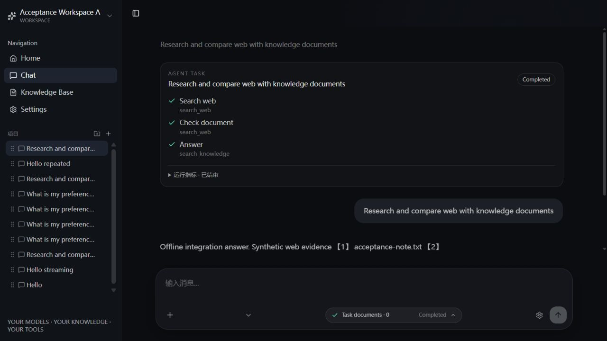

# Integration Acceptance V1

日期：2026-10-21。分支 `feat/agent-core`。原浏览器验收基于 `e5bd76ec51d13a204ac163b0a42edbbef0e1e904`；本轮 HTTP 复验使用该版本加迭代器兼容补丁，不冒充新的浏览器验收。

## 总结：本地检查通过，等待兼容补丁对应 CI

- **PASS**：独立 FastAPI + SQLite + Chroma 的真实 TCP/HTTP 17 项；真实 Vue 浏览器下的 Workspace/Session、Chat、SSE、Agent、Sources、Memory、刷新、Stop、超时提示。模型、Web 和 Embedding 均为离线替身。
- **本地 PASS / CI PENDING**：迭代器兼容补丁的针对性 77 项、完整后端 227 项及 65 个子测试、前端类型检查/10 项 Memory 测试/build 全部通过；真实 HTTP 17 项复验通过。`e5bd76e` 的旧 CI 失败作为历史证据保留，不能替代新提交的 CI。新 CI 成功前不解除验收阻断。
- **FAIL / P2 显示限制**：刷新后消息级 Token 徽标不恢复；正文、Sources、Agent Run 指标恢复。临时数据库中对应普通聊天的 6 Token 记录仍在，历史接口未返回单条 Usage，不是底层用量丢失。
- **BLOCKED**：用户 PostgreSQL 独立恢复/迁移验收，沿用既有权限阻断；本轮没有建立连接或重新验证权限。
- **NOT TESTED**：真实 LLM/Exa/Embedding、付费资源、生产数据、远程服务实际超时/限流、全量浏览器回归。本轮仅复验 HTTP 和离线回归；先前浏览器结果仍明确标注原运行版本，不将其当作本轮重新执行的浏览器测试。

## 真实调用链与数据保存

| 链路 | 实际入口/边界 |
| --- | --- |
| Workspace → Session → Chat | `useWorkspaces` 保存当前 ID；`useChat` 发送 workspace_id/session_id。`resolve_workspace_request()` 检查 Workspace、已有 Session 归属和每个 document_id。成功 `save_chat_turn()` 在事务中创建 Session、保存一对消息、Sources 和可得 Usage。新聊天开始时仅有客户端 ID，不等于已保存 Session |
| Chat → Provider → SSE | `/chat` 同步适配，`/chat/stream` → `_routed_events()` 分流；普通 Chat 共用 Provider/工具规范。`_stream_with_cleanup()` 迭代原有同步事件流，结束/断连时显式关闭；SSE 返回 `text/event-stream`、no-cache 和 error/done 协议 |
| Agent → Tool Registry → Web/RAG | `should_run_agent()` 确定性路由；`run_agent()` 复用现有规划/动作/Observation/预算循环；Registry 验证注册名与参数。Workspace 能力开关优先；即使请求试图打开被关闭的 Web，也不实际执行。RAG 查询按 Workspace/document 范围过滤 |
| Agent → Citation Registry → Sources | 工具结果进入同一个来源注册表，去重并生成稳定 marker/编号；最终生成前提供 catalog，CitationStream 分块校验并输出 `【n】`。Sources 事件、正文、成功保存后的 sources_json 回读必须一致 |
| Memory → Workspace → Chat/Agent | 独立 SQLite；用户确认 CRUD、版本冲突处理。`_conversation_messages()` 按最新用户问题检索当前 Workspace，受预算限制地注入 JSON user 数据与固定策略。Agent 复用一次检索快照，不追加模型请求；Memory 不进入 Chroma 或 Citation Sources |
| Observability → Run 持久化 → UI | monotonic 运行/模型/工具计时、TTFT、模型次数、可得 Usage 和失败类型，经既有 plan_json 版本封装保存；`agent_metrics` SSE 与 Workspace 作用域的详情接口投影到 AgentRunPanel，刷新后可恢复 |

相关代码：[Chat](../../backend/app/api/routes/chat.py)、[SSE](../../backend/app/api/routes/chat_stream.py)、[Agent](../../backend/app/agents/orchestrator.py)、[Registry](../../backend/app/tools/registry.py)、[Citation](../../backend/app/services/citations.py)、[Memory](../../backend/app/services/memory.py)、[Observability](../../backend/app/agents/observability.py)。

失败或取消允许存在 Run 而没有成功消息/历史 Session，这是执行审计与对话保存的区别。失败不会保存半截助手答案；预算耗尽可保存明确终止说明或部分结果。本轮验证取消、模型失败及无效引用均未保存半截消息。

旧历史接口仍支持缺省 workspace_id 的本地兼容调用；本轮通过的是显式 Workspace 作用域检查，不是多用户认证/互联网租户隔离审计。没有新增鉴权、收紧旧 API 或改变数据库结构。

## 独立环境与 Mock 边界

- 后端 `127.0.0.1:18800`，前端 `127.0.0.1:5179`；未占用用户的 8000/5173 服务。测试服务启动前切换到新临时目录，使相对 `.env` 不读取原项目配置，并清空 Provider 凭据环境项。
- 业务 SQLite、Memory SQLite、storage、Chroma 均在本轮独立临时目录中；真实文件上传接口解析合成 TXT、创建 documents 元数据并索引到临时 Chroma。Embedding 固定合成向量，因此不衡量语义召回率。
- Provider 复用 ReplayProvider，输出固定计划/合法工具调用和分块文本；模型能力目录仅在验收进程中替换，不需要伪造 API Key。Web handler 返回 `https://example.test/integration`，不是实时网页。
- 网络防护沿用离线测试机制，最终拦截尝试计数为 0；该保护不是完整操作系统沙箱。没有真实推理、Exa 或 Embedding 调用。
- FastAPI 路由、HTTP、SSE、Registry 参数校验、文件解析、SQLite/Chroma、Citation、取消和前端均使用实际实现，不以 TestClient 或 Generator 单测替代真实 HTTP。

## 实际 HTTP/SSE：17/17 PASS

机器记录：原 [integration-http-v1.json](integration-http-v1.json) 与本轮 [integration-http-close-compat-v1.json](integration-http-close-compat-v1.json) 均保留，后者 **17/17 PASS**。客户端使用实际 HTTPX TCP 连接、`trust_env=False`，先核对测试服务 marker，拒绝向非验收服务发聊天请求。

| 场景 | 实测条件与结果 |
| --- | --- |
| 普通同步聊天 | 1 次 Mock 模型调用，保存一对消息 |
| 普通 SSE | Content-Type 正确，多个 message 增量，唯一 done；保存正文与收到的文本一致 |
| Session/Workspace 隔离 | B 读取 A 的 Session 得空列表；借用 A Session 发请求被拒绝，Provider 不调用 |
| 文档隔离 | 合成 TXT 真实上传、indexed；B 文件列表不包含它，跨 Workspace document_id 请求被拒绝 |
| 多步 Agent + Web/RAG | 实际 Registry 执行 Web/知识检索；2 种 Sources，编号连续；source 先于 message，唯一 done；保存的 Sources/答案逐项相同 |
| Run/指标隔离 | 6 次 Mock 调用、3 个工具步骤、completed、指标 finished；B 查询或取消 A Run 返回 404 |
| Memory 修改与新 Session | BLUE → 版本 2 GREEN，新 Session 使用新值；过期修改 409，B 读取该记忆 404 |
| Memory 关闭与删除 | 关闭时 API 503、普通聊天成功且不注入；重新开启后删除，后续新会话无该记忆 |
| 禁用 Web | Workspace=false 且请求试图传 true，实际 Web 执行 0，无 Web 来源；不把最终答复存在当作搜索成功 |
| 模型失败 | failed/error，无 done，无保存 |
| Provider 超时 | Mock 抛 TimeoutError，failed/error，记录失败类型，无保存；不是实际远程网络超时 |
| 无效 Citation | 伪造编号被拒绝，不输出该编号，不保存失败回答 |
| Provider 中途错误 | 已开始输出后 Mock 异常，最终失败，不保存半截答案 |
| Token 预算 | 规划使用固定 10 Mock Token 后 budget_exceeded，模型调用仅 1 次、无工具步骤 |
| 显式取消 | 实际 cancel HTTP 请求后 cancelled，无 done、无历史消息 |
| 客户端断连 | 实际关闭 SSE TCP 响应后，Run 转 cancelled，历史为空；修复前此项失败 |
| 重复 POST 与无效 Workspace | 两次成功 POST 保存两轮共 4 条消息，未额外重复；不存在 Workspace 的同步/SSE 返回结构化错误，不截断连接 |

表中多步指标隔离与重复 POST/无效 Workspace 为合并展示，JSON 保留实际 17 个场景 ID。相同 POST 在服务端被视为新的聊天轮次，当前没有通用 request-id 幂等机制；不能将两次成功请求的 4 条消息误报为恰好一次保存保证。

## 浏览器：实际 Vue + FastAPI

后台持久化核对：[integration-browser-v1.json](integration-browser-v1.json)。所有数据均为合成内容，未打开合成网页外链。

| 操作 | 实际观察 |
| --- | --- |
| 创建 Workspace/聊天 | UI 创建 Browser Integration Workspace，发送普通聊天后 Session 出现在侧边栏；显示多个增量后的完整答案 |
| Memory CRUD/注入 | Settings 创建 preference=BROWSER_BLUE；新 Session 显示 BLUE；修改为 BROWSER_GREEN 后新 Session 显示 GREEN；删除后新 Session 不再注入 |
| 刷新一致性 | 正文、Sources 和 Run completed/指标均恢复；消息级 Token 徽标有下述 P2 限制 |
| Agent/RAG/Sources | 显示实际三步执行、completed；正文 `【1】` 对应网页工具 URL、`【2】` 对应 acceptance-note.txt；展开知识来源显示合成原文，展开运行指标可见 6 次调用、56 Mock Token |
| Stop | UI 显示 Cancelled 和“部分答案不作为历史发送”；后端实查 cancelled/user_cancelled、metrics finished、消息数 0 |
| 错误提示 | 超时任务显示 Failed/TimeoutError；后端 failed、消息数 0 |
| 控制台 | 最终采集的 error 日志为空；不等于完成所有浏览器/网络错误场景验收 |

实测浏览器完成的 Agent：531ms 总时长、203ms TTFT、6 次模型逻辑调用、45+11=56 Mock Token。Stop Run 4422ms，Usage 未知；超时 Run 32ms，Usage 未知。这些是离线替身的计时/固定 Usage，不是真实服务性能或账单，也不是平均成功率统计。



## 发现的问题与处理

### P1：无效 Workspace 导致 Agent SSE 截断 — 已修复

复现：不存在的 workspace_id + 复杂目标请求 `/chat/stream`；客户端收到 RemoteProtocolError，而普通 Chat 收到 error 事件。`create_agent_run()` 位于原有异常处理之前。提交 `c900c63a170a6714671d8f950d85af5fb53e222e` 增加初始化 ValueError 保护，未创建 Run/调用模型/保存消息。19 项针对性测试与实际 HTTP 四路径验证通过，该提交 CI 通过。

### P1：TCP 断连后 Run 未终止 — 实际 HTTP 已修复，等待新 CI

复现：较慢 Agent 第一个 message 后关闭 TCP 响应，5 秒后 Run 仍为 replanning、metrics.finished=false；没有保存半截消息。ASGI 取消异步迭代未可靠关闭底层同步 Generator。提交 `e5bd76ec51d13a204ac163b0a42edbbef0e1e904` 增加显式嵌套关闭和 shielded 清理；29 项针对性测试、实际 HTTP 17 项及浏览器 Stop 通过。

### CI 阻断：旧 Mock 返回不可关闭迭代器 — 本地修复通过，等待新 CI

[失败 CI](https://github.com/chenmaojie-degithub/Personal-AI-Workspace/actions/runs/39526851205)：后端 `AgentOrchestratorTests.test_complex_request_is_dispatched_through_agent_sse` 使用 `iter([...])`，`contextlib.closing` 在退出时直接调用不存在的 `.close()`。这是迭代器契约兼容回归，不是 Linux/Python 3.12 独有问题。后端 201 passed、1 failed、65 subtests passed；前端通过。

本轮获授权后，在 `chat_stream.py` 两处边界仅对 `callable(getattr(iterator, "close", None))` 注册或执行关闭；Agent 复用 ExitStack，ASGI 保留 CancelScope(shield=True) 和线程池清理。没有无条件捕获清理异常，没有改动旧 Mock，也没有改变 Run/消息保存逻辑。

两项新增测试曾失败，是辅助函数硬编码期待 `Synthetic failure`，与关闭异常测试的 `Cleanup failed` 冲突。辅助函数现直接传播异常，由调用方分别断言：

- 仅迭代失败：原 `Synthetic failure` 传播，真实生成器 finally 执行一次。
- 正常耗尽或提前关闭时清理失败：`Cleanup failed` 必须传播。
- 迭代与清理同时失败：传播 `Cleanup failed`，其 `__context__` 保留原 `ValueError("Iteration failed first")`。
- 普通 list_iterator、不具备可调用 close 的对象，均可正常完成或提前结束；迭代异常不因清理兼容而改变。

原两项测试 **2/2 PASS**；相关 SSE/Agent/Observability **77 PASS**；完整 pytest **227 PASS + 65 子测试 PASS**；vue-tsc、10 项前端 Memory 测试、build 均通过。只有既有 Starlette 弃用、Node 类型剥离实验提示与 Vite 包大小告警。

实际 TCP/HTTP 17 项复验全部通过；另外从实际详情/历史接口核对 TCP 断连与显式取消均 cancelled、模型错误/超时均 failed，四者 metrics.finished=true 且保存消息为 0；完成任务 completed、finished=true、保存 2 条消息。本轮记录 47 次 Mock Provider 调用、10 次 Mock Web handler 调用、外部网络拦截尝试 0；真实 API 调用 0。旧浏览器证据未重写。新 CI 尚未完成，不能据本地通过宣称整个验收通过。

### P2：消息级 Token 徽标刷新不恢复 — 未修复

复现：普通聊天完成显示 6 tokens → 页面刷新 → 正文仍在但徽标消失。临时库 token_usage 仍记录 6，历史接口没有逐消息 usage 字段；Agent 的独立 Run 指标则正常恢复。本轮不扩展消息历史协议或假造 Usage 映射，后续应明确历史 Usage 的关联/回读方案。

验收脚本自身曾将创建 Workspace 的成功码误断言为 200（实际约定为 201），并遗漏模型目录导入别名的 Mock；均已修正测试环境后复测，不列作产品缺陷。提交前检查脚本的 Windows GBK 解码问题也不属于应用故障。

## PostgreSQL：BLOCKED

仅检查配置定义/既有文档和非破坏性方案；未读取原 `.env` 密钥、未建立 PostgreSQL 连接、未恢复或迁移用户数据库。既有 [2026-10-20 记录](citation-live-postgres-2026-10-20.md) 表明独立恢复库创建曾因 CREATEDB 不足失败，本轮不重新断言实时权限状态。

后续需管理员预建隔离恢复库，以范围受限账号恢复备份、核对消息/Sources/Workspace，再单独批准增量迁移；不提升业务账号全局权限，不回写原库。SQLite 和临时 Chroma 通过不替代 PostgreSQL 恢复/旧列迁移验收。

## 复现与下一步

```powershell
# backend，终端一；专用临时数据库，无原项目 .env
.venv/Scripts/python.exe -m scripts.serve_integration_acceptance
# backend，终端二；仅访问具有验收 marker 的 loopback 服务
.venv/Scripts/python.exe -m scripts.check_integration_acceptance ../integration-http-results-new.json
# frontend，另一个终端
$env:VITE_API_BASE_URL='http://127.0.0.1:18800'
node node_modules/vite/bin/vite.js --host 127.0.0.1 --port 5179 --strictPort
```

测试服务包含仅本地的控制接口，不能部署生产。结束时关闭独立浏览器页与两个测试进程；本轮已关闭。未做破坏性用户数据操作，没有数据库结构变更。

原失败检查点按 AGENTS.md 停止后，本轮在用户明确授权下完成上述窄范围兼容修复与本地复验。报告、离线脚本和已核对的合成证据将随功能分支提交；原 Memory 截图未作为有效内容证据，也不删除或覆盖它。下一步先核对补丁提交的 CI，成功后才更新本报告的相应范围结论和 Draft PR #1。不合并 main、不创建 Tag/Release。

后续真实模型预算建议（**未执行，需逐阶段批准**）：先 1 次简单请求（输入≤1500、输出≤128）；再一个最多 6 次模型调用的两工具 Agent（累计输入≤8000、输出≤1200、90 秒）；最后 1 次 Memory 问答（输入≤1500、输出≤128）。优先回放工具结果，不请求 Exa；若验真实 Exa，另批准最多 1 次。届时核查已配置模型的 tools 支持、可用性与价格，不切付费模型、不重试或充值；价格未知时不能把费用写为 0，也不启动调用。
