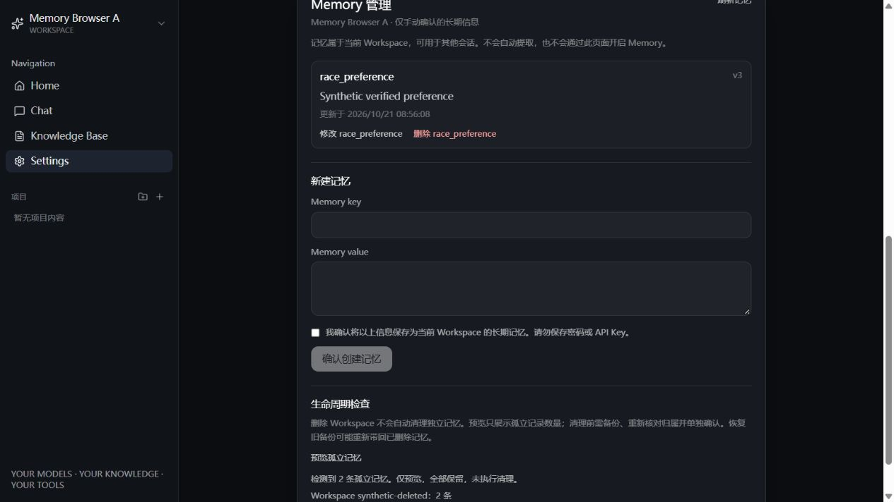

# Memory V1.1 — 管理界面与生命周期

日期：2026-10-21。基于 [Memory V1](memory-v1.md) 的独立 SQLite 和已验证 CRUD，本轮不改变检索、注入预算、去重或冲突算法，不扩展自动记忆、语义搜索或后台任务。

## Settings 管理交互

- 新增 `MemoryCard.vue`，复用现有 Workspace 状态、Vue 和暗色卡片样式；显示当前 Workspace 的 key、value、更新时间与 version。列表显式请求 `limit=200`，覆盖 V1 的 Workspace 容量上限。
- 新建/修改必须勾选明确的长期保存确认；修改固定 key，并携带编辑开始时的 `expected_version`。提交期间禁用重复操作，服务端仍以现有事务/唯一约束/版本检查为准。
- 409：请求刷新列表，保留草稿、取消确认；检测到新版本后阻止旧版本再次保存。用户可点击“载入最新版本（会替换草稿）”，核对后重新确认，不自动覆盖冲突记录。
- 删除先展示独立确认区域，取消不发请求；确认才携带 `expected_version` 删除。界面提示后续检索停止，但历史回答、备份及已开始的运行快照不被追溯抹除。
- 503：显示“未启用或存储暂不可用”，禁用写入，保留手动刷新；不把所有 503 假定为单一配置原因。404 清除失效列表，网络写入失败提示结果未知，要求先刷新核对，不自动重试。
- Workspace 变更立即清空列表、草稿、确认状态、错误和预览，取消旧请求。响应同时校验 Workspace 与请求代次；同 Workspace 的多次读取另有序号，JSON body 读取完成后也校验。A→B→A、迟到的错误、写入结果和卸载后的响应均不能污染新状态。
- 记忆仅存在组件/组合函数内存中，卸载时清空；不把 key/value 写入 localStorage。现有 Workspace ID 保存机制不变。刷新通过 API 重读，不依赖浏览器保存完整记忆。

`MEMORY_ENABLED` 默认仍为 false，没有启用控件、`.env` 修改、服务重启或数据库迁移。

## API 与数据库变更

管理页面复用 V1 的 `/workspaces/{workspace_id}/memories` GET/POST/GET by ID/PATCH/DELETE；新建增加唯一的只读生命周期入口：

```http
GET /memory/maintenance/orphans
```

示例（仅合成数据）：

```json
{
  "orphans": [{"workspace_id": "synthetic-deleted", "count": 2}],
  "record_count": 2,
  "action": "retain",
  "atomic_snapshot": false
}
```

返回仅有孤立 Workspace ID、数量与保留标记，不返回 memory ID、key/value。全局检查只适用于当前本地单用户应用，不提供多用户管理员认证；不得把此接口视为具备互联网多租户授权。

**没有数据库字段/表/版本变更**，仍为独立 SQLite `memories` + user_version=1。新增查询只按 Workspace 分组计数；存储打开与模式保护沿用 V1。配置关闭时先返回 503，不打开业务库做检查。工作区清单失败或为空时返回 503，绝不把“数据库不可用”解释为“所有记忆均孤立”。

本轮未连接或修改用户 PostgreSQL，未触碰现有聊天、上传文件或 Chroma 数据，也没有重建向量集合。

## 生命周期策略：检测、预览、保留

1. Workspace 删除仍按原有业务流程执行，不新增 Memory 删除副作用。删除确认界面明确提示可能保留孤立记忆。
2. 检查时读取当前 Workspace 清单，再与独立 SQLite 的 Workspace 计数比较。不存在的 Workspace 对应记录被标为“候选孤立记录”，全部保留。
3. 已删除 Workspace 的普通 Memory API 返回 404，聊天的 Workspace 校验也会拒绝访问；预览只暴露数量，不借此恢复或展示原文。
4. **两个数据库之间没有原子快照或跨库事务。** 清单读取后 Workspace 可能被删除或恢复，因此预览既不是完整一致性证明，也不是永久清理授权。
5. V1.1 不提供孤立记忆批量清理 API、自动清理按钮或无条件 DELETE。确需清理时，必须在维护窗口停写、备份并恢复演练、重新核对 Workspace 和记录清单，再由用户针对明确范围单独确认；清理实现另行评审。不能伪称跨库原子删除已经实现。

## 导出、恢复与删除的风险

| 操作 | 风险 | 本轮策略/验证 |
| --- | --- | --- |
| 导出/备份 | SQLite 文件可能包含多个 Workspace、孤立记录及私人信息；日志/Git/共享目录会造成泄露 | 仅延续离线 `Connection.backup()` 方案，不新增网页导出或日志输出；所有自动测试使用合成记录和临时文件 |
| 恢复 | 旧备份可能使已删除记录重新出现，也可能覆盖新值/版本或绑定已经不存在的 Workspace | 仅恢复到新的独立路径，integrity_check 与逐条核对；不覆盖活动存储；测试明确验证旧副本仍有被删除记录、活动库仍没有 |
| 并发更新 | 两个编辑者持有相同版本，后写可能覆盖先写 | 沿用 BEGIN IMMEDIATE 与 expected_version；并发测试验证仅一个更新成功，另一个冲突；同键同值并发创建返回同一记录 |
| 中断/重复提交 | 浏览器取消不保证服务端事务已回滚，丢失响应时可能已提交 | UI 禁用重复提交、取消陈旧请求，但不自动重试；重新读取后再决定。已有幂等创建和版本检查继续生效 |
| 删除记忆 | 当前记录消失并不等于安全擦盘或历史副本消失 | 删除后新检索为空；SQLite 残页、备份、之前回答不承诺擦除；恢复需核对删除记录 |
| 旧 Agent Run | 已生成的内存会话快照可能仍含之前检索到的信息 | 不追溯改写正在执行的消息列表；测试保留旧快照并验证下一次检索为空。没有新增完整 Prompt/记忆快照持久化 |

## 自动测试与真实浏览器验收

| 验证层 | 实际结果 | 边界 |
| --- | --- | --- |
| Memory 针对性 pytest | 30 passed：V1 22 项 + 生命周期 8 项 | 临时 SQLite、Mock RAG/Provider；包括真实 Workspace 删除路由保留记忆、仅数量预览、清单故障保护、并发写入、备份复活风险、关闭 Memory 的普通 Chat |
| 前端组合函数测试 | 10 passed | Node 内置 test + Vue effectScope，Mock fetch；CRUD 请求、确认、409/503、乱序 body、重复提交、A→B→A、卸载、网络错误、404、预览与 localStorage 访问防护 |
| 完整后端 | 195 passed，29.49s | 沿用离线网络防护，不连接真实服务/用户数据库 |
| TypeScript / build | `npx vue-tsc --noEmit` 和 `npm run build` 通过 | 原有 Starlette 弃用/Vite 大包警告；Node 22 strip-types 有实验性提示 |
| 真实浏览器 + Mock API | 下表 10 项通过 | 实际本地 Vue 页面、独立 origin 5178 + 合成 API 18765；不等于真实 PostgreSQL 或真实模型端到端验收 |

浏览器实际操作记录：

| 项目 | 已观察结果 |
| --- | --- |
| 创建确认 | 未勾选时按钮禁用；确认后创建，列表显示 value/version/更新时间 |
| 修改版本 | API 请求携带 expected_version=1，成功显示 v2 |
| 409 冲突 | 列表显示服务端新版本，草稿保留、确认清除；旧版本保存被禁用；显式载入最新版本后成功保存 |
| Workspace 切换 | A 的列表/草稿不出现在 B，切回 A 重新读取 |
| 页面刷新 | 页面 reload 后从 Mock API 恢复列表与版本 |
| 删除确认 | 取消保留记录且不产生 DELETE；确认后仅一个 DELETE，携带版本 3，记录从列表消失 |
| 503 | 管理区显示明确提示，输入/写入禁用；没有启用配置 |
| 孤立预览 | 显示合成孤立数量 2、全部保留及非原子说明，无清理操作 |
| 延迟响应竞态 | 人为挂起 A 的 GET，切 B 后释放；B 仍为空，没有 A 的记忆 |
| 浏览器控制台 | 最终采集 error 日志为空；没有真实 Provider 调用 |



### 复现

```powershell
# 后端（全部使用临时数据）
Set-Location backend
.venv/Scripts/python.exe -m pytest -q -o addopts= app/tests/test_memory.py app/tests/test_memory_lifecycle.py

# 另一个终端，从 frontend 目录
npm run test:memory
npx vue-tsc --noEmit
npm run build

# 独立浏览器验收服务，不启动真实后端
node tests/memory-browser-harness.mjs
# 打开 http://127.0.0.1:5178/settings；结束时 Ctrl+C
```

浏览器 harness 仅绑定 loopback，模拟全部 API，无数据库或上游客户端；`/__test/state` 为该独立端口的合成测试控制入口，可切换 enabled/conflictOnce/holdNextList/releaseList，不能部署到生产。服务关闭即丢弃全部合成记录。前端 `test:memory` 已加入现有 CI，无新增依赖或大型 UI/测试框架。

## 交付边界

生产 PostgreSQL 恢复/迁移仍未验收，Memory 默认关闭、真实模型未验收。没有自然语言写入、自动提取、语义搜索、在线导出恢复或孤立记忆永久清理。新增前端/生命周期代码可以随应用回滚，数据库无迁移需要回滚；保留独立记忆文件及备份。后续如需永久清理或生产恢复，须另行确认明确的数据范围与恢复方案。
