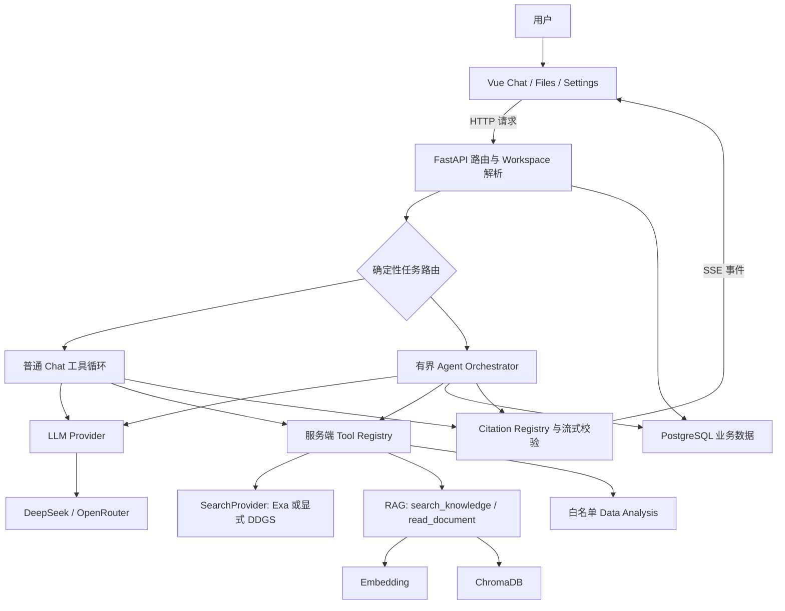

# Personal AI Workspace：技术栈、架构原理与进阶知识全景手册

> 面向：项目作者、AI 应用工程师面试准备，以及后续工程学习。
>
> 核对日期：2026-10-20；代码依据：`feat/agent-core` 的 `976e0fc`。
>
> 本文解释“为什么这样实现、技术解决什么问题、以后还需要懂什么”，不是只介绍长期记忆，也不是未来功能的完成清单。

## 阅读导航

- [一、先回答：我的框架到底基于什么](#一先回答我的框架到底基于什么)
- [二、当前技术栈与能力边界](#二当前技术栈与能力边界)
- [三、专题详解](#三专题详解)：01—32，每个专题都说明概念、原理、项目实现、关键知识、实例、风险和演进。
- [四、容易混淆的概念对照](#四容易混淆的概念对照)
- [五、学习路线与项目练习](#五学习路线与项目练习)
- [六、面试时如何解释这个项目](#六面试时如何解释这个项目)
- [七、代码索引与资料](#七代码索引与资料)

### 如何理解“已实现”

本文区分四类证据：**代码已实现、离线测试通过、真实服务验证、未来方向**。代码存在不代表生产可用；一次真实请求成功不代表长期稳定。本文没有为写文档新增 Exa、Embedding 或 LLM 推理调用。

最近的验收事实是：Citation 最终回答协议完成过一次获批的真实免费模型流式检查；此前 HTTP 与浏览器主要使用回放后端。PostgreSQL 中 `sources_json` 已存在，已做只读检查和备份归档检查，但隔离恢复因账号无 `CREATEDB` 权限阻断，不能宣称真实恢复/迁移验收全部完成。参见[最新验收记录](acceptance/citation-live-postgres-2026-10-20.md)。

## 一、先回答：我的框架到底基于什么

### 1.1 一句话定位

**这是一个以 Vue 3 为交互层、FastAPI 为服务层，以自建有界 Agent Orchestrator 组织模型和工具，使用 PostgreSQL 保存业务状态、ChromaDB 提供文档向量检索的全栈 AI 应用。**

它主要属于 **LLM 应用工程 / Agent 应用工程**。项目调用已有模型，没有在本地训练基础大模型；使用 `openai` Python SDK 的兼容接口，也不意味着必须调用 OpenAI 的模型。DeepSeek、OpenRouter 是当前聊天 Provider 的具体实现。

### 1.2 “框架”要分层回答

| 层次 | 当前选择 | 实际职责 |
| --- | --- | --- |
| 前端框架 | Vue 3、Composition API、Vue Router | 组件、页面、响应式状态、路由 |
| 前端构建与类型 | Vite、TypeScript、vue-tsc | 开发服务、构建产物、静态检查 |
| 后端框架 | FastAPI、Starlette/ASGI、Uvicorn | HTTP、参数模型、流式响应、服务进程 |
| 业务架构 | 自建模块化后端 | Chat、Workspace、文档、Provider、Tools、Agent 分工 |
| Agent 编排 | 自建 Orchestrator | 规划、工具执行、观察、调整、预算、结束 |
| 模型接入 | Provider 抽象＋兼容 Chat Completions 接口 | 隔离模型供应商差异 |
| 检索系统 | 自建 RAG 流程＋FastEmbed/兼容 Embedding＋ChromaDB | 文档处理、向量化、相似检索 |
| 业务存储 | PostgreSQL，兼容 SQLite 路径 | 聊天、来源、Workspace、任务和文档元数据 |

**当前未基于 LangChain、LangGraph 或 LlamaIndex 实现运行时编排。** 可以借鉴其概念，但不能在简历里写“本项目使用 LangGraph”，也不能因为用了 Embedding 就说“底层是某个 Agent 框架”。没有必要为了名称更流行而迁移已有代码。

### 1.3 实际架构

注意：当前存在普通聊天和 Agent 两条路由，**不是每句简单聊天都强制规划一次**。Agent 复用 Provider、Tool Registry、检索与 SSE 能力，普通聊天保留轻量路径。完整系统应描述为“共享基础能力的两种执行方式”。

### 1.4 数据分别存在哪里

| 数据 | 当前存储/处理位置 | 为什么分开 |
| --- | --- | --- |
| Workspace、会话、消息、Usage | 关系数据库 | 需要事务、顺序、关联和持久化 |
| Agent Run / Step、计划、状态 | 关系数据库 | 刷新恢复与任务审计 |
| 文档身份、哈希、解析状态 | `documents` 元数据表 | 追踪文件生命周期 |
| 文档 chunk、向量和检索元数据 | ChromaDB | 语义相似检索 |
| 上传原文件 | 本地 storage 目录 | 解析、重新处理与来源定位 |
| CSV/XLSX、生成图表 | Workspace 文件及分析目录 | 数据分析，不自动进入向量库 |
| 本地 Embedding 模型 | 模型缓存目录 | 避免重复下载模型权重 |
| 当前 UI 状态、流式片段 | 浏览器响应式内存 | 即时展示，不等于可靠业务存储 |
| 部分选择项/会话标识 | 浏览器 localStorage | 页面偏好和恢复线索，不能代替授权 |
| Web 搜索结果 | 工具观察、回答上下文、来源元数据 | 当前不自动写入 ChromaDB |

## 二、当前技术栈与能力边界

### 2.1 依赖清单：技术与问题的对应关系

下列版本是代码审查时依赖文件里的**声明**，不是对所有机器安装版本的推断。`^` 版本范围需要结合锁文件解释，不能当作精确运行版本。

| 技术 | 声明版本/形式 | 在项目解决的问题 |
| --- | --- | --- |
| Vue / Vue Router | Vue `^3.5.24` / Router `^4.5.0` | 交互组件、页面切换、响应式状态 |
| TypeScript / vue-tsc | `~5.9.3` / `^3.1.4` | 前端类型约束、Vue 模板类型检查 |
| Vite / Vue 插件 | Vite `^7.2.4` | 本地开发、模块转换、生产构建 |
| Tailwind CSS | `^4.1.18` | 样式约束、响应式布局、状态样式 |
| Reka UI、Lucide、VueUse | 组件与工具依赖 | 弹层、图标和交互辅助，不承担 Agent 决策 |
| marked / DOMPurify | `18.0.13` / `3.4.15` | Markdown 转换与 HTML 清洗，两者职责不同 |
| Three.js | `0.186.0` | 首页 WebGL 图库视觉，不是 AI 模型推理引擎 |
| FastAPI / Uvicorn | `0.115.6` / `0.32.1` | 类型化 API、ASGI 服务与流式响应 |
| Pydantic / pydantic-settings | `2.10.4` / `2.7.0` | 请求/响应校验、配置读取 |
| openai Python SDK | `1.57.4` | 调用兼容聊天/Embedding 接口，不表示模型归属 |
| httpx | `0.28.1` | Exa 等 HTTP 请求、超时和错误处理 |
| psycopg | `3.3.6` | Python 访问 PostgreSQL，当前不是 ORM |
| SQLite | Python 标准库路径 | 隔离测试与兼容存储，不是生产 PostgreSQL 的完全等价替代 |
| ChromaDB | `0.5.23` | 本地持久化向量检索及元数据过滤 |
| FastEmbed | `0.8.0` | 本地文本 Embedding |
| pypdf / python-docx | `5.1.0` / `1.1.2` | PDF/DOCX 文字及结构读取，不自动具备 OCR |
| python-multipart | `0.0.12` | 接收表单文件上传 |
| Exa Search API | HTTP 外部服务 | 当前默认网页搜索，`auto`、最多 5 条、highlights |
| DDGS | `9.16.0` | 显式选择的备用搜索实现，不是 Exa 的静默自动降级 |
| pandas / openpyxl | `3.0.6` / `3.1.5` | CSV/XLSX 的数据计算与读取 |
| matplotlib | `3.11.2` | 服务端图表渲染 |
| pytest / Mock / TestClient | 测试工具 | 回归、故障注入、隔离 Provider 测试 |
| Git / GitHub Actions | 工程流程 | 提交追踪、分支保护约定、后端和前端 CI |

代码依据：[后端依赖](../backend/requirements.txt)、[前端依赖](../frontend/package.json)、[CI](../.github/workflows/ci.yml)。

### 2.2 当前状态速查

| 能力 | 状态与准确说法 |
| --- | --- |
| 多模型聊天、流式文本、历史恢复 | 已有实现与回归，模型能力受 Provider 实际支持限制 |
| Workspace 工具开关和数据范围 | 已实现；没有因此自动获得完整多用户认证体系 |
| 有界 Agent、公开计划、观察和调整 | 已实现；不等于无限自主执行或分布式工作流平台 |
| Run/Step 持久化 | 已实现执行记录保存；不等于重启后自动从任意一步安全续跑 |
| RAG、PDF 页码、文档分段读取 | 已实现文本检索基础；扫描 PDF OCR、复杂表格理解不是现成能力 |
| Web 搜索 | Exa 默认，DDGS 可显式切换；搜索服务可能超时、限流或返回低相关内容 |
| Citation 稳定编号与保存 | 已实现；真实模型完成一次协议验证；引用正确不等于事实正确 |
| CSV/XLSX 分析、图表 | 已实现白名单计算，不运行模型生成的任意 Python |
| 长期用户记忆 | 尚无独立长期记忆管理链路，聊天记录与 RAG 不能直接冒充它 |
| 混合检索、Reranker | 当前未实现完整专用链路，是未来评估后可选方向 |
| Redis、Celery、MCP、专用多 Agent 框架 | 当前未接入，本文后文仅讲概念和触发条件 |
| 模型训练、微调、自建 GPU 推理服务 | 当前未实现，也不是现有功能运行的前提 |
| 登录、多用户 RBAC、公开生产部署 | 不应因有 Workspace 就宣称已完成 |
| 图片生成 | 仍存在 Stub，不是已交付的真实生成能力 |

## 三、专题详解

### 专题索引

- [专题 01：全栈架构、模块分层与设计模式](#专题-01全栈架构模块分层与设计模式)
- [专题 02：Vue 响应式、组件与前端状态管理](#专题-02vue-响应式组件与前端状态管理)
- [专题 03：TypeScript、数据契约与运行时校验](#专题-03typescript数据契约与运行时校验)
- [专题 04：交互动画、渲染、Markdown 与界面安全](#专题-04交互动画渲染markdown-与界面安全)
- [专题 05：FastAPI、ASGI、并发与接口设计](#专题-05fastapiasgi并发与接口设计)
- [专题 06：PostgreSQL、事务、迁移与恢复](#专题-06postgresql事务迁移与恢复)
- [专题 07：文档摄取、解析与数据生命周期](#专题-07文档摄取解析与数据生命周期)
- [专题 08：LLM、Transformer、Token 与生成过程](#专题-08llmtransformertoken-与生成过程)
- [专题 09：Provider 抽象、模型路由与能力协商](#专题-09provider-抽象模型路由与能力协商)
- [专题 10：Prompt Engineering 与 Context Engineering](#专题-10prompt-engineering-与-context-engineering)
- [专题 11：Tool Calling、JSON Schema 与安全执行](#专题-11tool-callingjson-schema-与安全执行)
- [专题 12：Agent、规划、观察与 Replanning](#专题-12agent规划观察与-replanning)
- [专题 13：预算、取消、错误恢复与部分完成](#专题-13预算取消错误恢复与部分完成)
- [专题 14：SSE、流式协议与增量一致性](#专题-14sse流式协议与增量一致性)
- [专题 15：Embedding、向量相似度与向量数据库](#专题-15embedding向量相似度与向量数据库)
- [专题 16：RAG、分块、检索与文档阅读](#专题-16rag分块检索与文档阅读)
- [专题 17：混合检索、BM25、Reranker 与 GraphRAG](#专题-17混合检索bm25reranker-与-graphrag)
- [专题 18：Citation、证据溯源与 Grounding](#专题-18citation证据溯源与-grounding)
- [专题 19：Web Search、Exa、信息时效与搜索质量](#专题-19web-searchexa信息时效与搜索质量)
- [专题 20：Data Analysis、精确计算与图表](#专题-20data-analysis精确计算与图表)
- [专题 21：AI 长期记忆、短期记忆与个性化](#专题-21ai-长期记忆短期记忆与个性化)
- [专题 22：Agent State、Checkpoint、恢复与幂等性](#专题-22agent-statecheckpoint恢复与幂等性)
- [专题 23：缓存、性能、TTFT 与成本优化](#专题-23缓存性能ttft-与成本优化)
- [专题 24：评估体系、测试集与任务成功率](#专题-24评估体系测试集与任务成功率)
- [专题 25：可观测性、Trace、指标与费用归因](#专题-25可观测性trace指标与费用归因)
- [专题 26：Workspace 隔离、权限、隐私与 AI 安全](#专题-26workspace-隔离权限隐私与-ai-安全)
- [专题 27：MCP、外部连接器与工具标准化](#专题-27mcp外部连接器与工具标准化)
- [专题 28：Workflow、多 Agent 与 Human-in-the-Loop](#专题-28workflow多-agent-与-human-in-the-loop)
- [专题 29：微调、LoRA、量化与本地模型推理](#专题-29微调lora量化与本地模型推理)
- [专题 30：部署、后台任务、并发与系统扩展](#专题-30部署后台任务并发与系统扩展)
- [专题 31：测试隔离、Git、CI/CD 与发布证据](#专题-31测试隔离gitcicd-与发布证据)
- [专题 32：多模态、OCR、图像、音频与数据理解](#专题-32多模态ocr图像音频与数据理解)

## 专题 01：全栈架构、模块分层与设计模式

### 是什么

全栈应用同时包含交互界面、服务逻辑和数据存储。模块分层的目的，是让“展示答案”“决定下一步”“调用外部服务”“保存记录”分别有清晰责任，避免一个 Chat 函数承担所有变化。

### 工作原理与关键概念

当前可以理解为模块化单体：后端一个应用进程内有路由、服务、Provider、工具和数据库模块。Provider/搜索接口体现适配器与策略思想；注册表将工具定义和执行入口集中。它们是设计方式，不是额外安装的神秘框架。

### 当前技术与代码位置

Vue 页面通过 HTTP 调用 FastAPI；模型实现位于 `providers/`，执行编排位于 `agents/orchestrator.py`，工具许可位于 `tools/registry.py`。`api/routes/chat.py` 仍承担较多业务逻辑，不能把理想分层描述成已经完全解耦。

### 解决什么问题

替换 DDGS 为 Exa 时，搜索内部变化可以留在 SearchProvider 层；新增模型不必改写前端消息组件。这减少修改影响范围，也让 Mock 能替换外部依赖进行测试。

### 例子与验收方法

画出一次请求经过的模块，解释每层输入和输出。更换搜索实现后，检查 `search_web(query)` 的接口、Citation 和 Workspace 开关是否保持一致，而不是只检查新服务能返回 HTTP 200。

### 容易误解的地方

模块多不等于微服务；存在类和接口不等于框架成熟。分层也不应演变成每个函数都包一层抽象。当前应用没有必要仅为了架构名称引入服务发现和容器集群。

### 后续需要学习

学习依赖方向、职责边界、适配器、策略、依赖注入、模块化单体与微服务的取舍。只有独立部署、伸缩或团队边界带来真实需求时，再考虑拆服务。

### 应能回答的问题

“为什么搜索服务和模型 Provider 分开？为什么编排层不直接拼接 Exa 请求？一次工具变更怎样证明没有影响普通聊天？”

## 专题 02：Vue 响应式、组件与前端状态管理

### 是什么

响应式系统把数据变化映射为界面更新。组件拆分让消息气泡、输入框、模型选择器、执行状态、Workspace 设置各自管理展示职责；Composition API 用函数组织可复用状态和行为。

### 工作原理与关键概念

`ref` 保存响应式值，`reactive` 包装对象，`computed` 表达派生状态，`watch` 响应外部变化。异步请求返回的先后顺序不一定等于用户点击顺序，所以恢复会话时还需要版本号或请求身份判断。

### 当前技术与代码位置

核心状态在 `frontend/src/lib/chat.ts`、`workspaces.ts`；页面在 `pages/`；`MessageBubble.vue` 展示内容和来源。当前是基于 Vue 的组合式状态模块，不应说已经采用 Pinia 或 Vuex。

### 解决什么问题

流式片段到达后能持续追加；切换 Workspace 时更新模型与会话列表；旧请求晚返回时，不应覆盖新会话。先前“新聊天似乎不见了”就需要分别检查排序、会话恢复和异步状态，而不是只检查数据库有没有记录。

### 例子与验收方法

连续快速切换 A、B 会话，故意让 A 的请求慢返回，确认界面仍是 B；刷新后来源恢复；生成中切换/停止的状态明确。检查 loading、restoring、incomplete 是否代表不同状态。

### 容易误解的地方

localStorage 只是浏览器侧保存，不是服务端事实来源，更不是权限凭证。刷新能恢复聊天，不代表模型具有长期记忆；UI 显示 Completed，也必须与服务端 Run 状态核对。

### 后续需要学习

掌握组件生命周期、清理监听、取消请求、竞态条件、单一事实来源、乐观更新与回滚。状态复杂到难以维护时再评估专用状态库，不为简单功能增加依赖。

### 应能回答的问题

“响应式和普通变量的差别是什么？为什么请求有版本号？如何避免切换会话后旧回复进入新会话？”

## 专题 03：TypeScript、数据契约与运行时校验

### 是什么

数据契约规定前后端如何理解消息、来源、工具调用和任务状态。TypeScript 在开发阶段发现类型问题；Pydantic 和服务端参数校验处理真正到达边界的数据。这是互补关系。

### 工作原理与关键概念

静态类型在编译/检查时工作，运行时 JSON 仍可能缺字段、字段改名或类型错误。可选字段、默认值、版本兼容、判别联合和 `additionalProperties: false` 用来减少契约歧义。

### 当前技术与代码位置

后端 `models/chat.py` 定义 `ChatRequest`、`CitationSource` 等；前端 `lib/chat.ts` 定义对应类型；Tool Registry 提供 JSON Schema 并执行校验。当前前后端类型仍有人工对齐工作，并非自动生成的统一模型。

### 解决什么问题

引用增加可选 `citation_id` 时，旧来源仍能显示；工具只允许 `query` 时，模型自造 `source`、`count` 应被拒绝。字段一致性直接影响设置保存、来源展示和工具安全。

### 例子与验收方法

分别提交缺少 `query`、额外参数、字符串冒充整数、超界 top_k 的调用，确认服务端明确拒绝。执行 `vue-tsc` 之外，还应测试真实 JSON 在后端和 SSE 消费者中的行为。

### 容易误解的地方

`as CitationSource` 是前端类型断言，不会把恶意 JSON 变成安全数据。Pydantic 校验通过，也不代表该文档属于当前 Workspace；结构校验和权限校验需要分别执行。

### 后续需要学习

学习 OpenAPI、JSON Schema、契约测试、破坏性变更、向后兼容和 schema 演进。规模扩大后可评估从 OpenAPI 生成前端类型，但先解决真实的字段漂移问题。

### 应能回答的问题

“为什么 TypeScript 不能代替后端验证？新增字段怎样避免旧消息报错？Schema 合法为什么还可能越权？”

## 专题 04：交互动画、渲染、Markdown 与界面安全

### 是什么

交互工程不仅是美化页面，还包括拖拽命中、展开/收起状态、布局稳定、可访问性和不可信内容渲染。AI 应用里生成的文本、URL 和文件名都不是可信 HTML。

### 工作原理与关键概念

DOM 布局决定元素几何位置，transform/opacity 通常适合动画；Teleport 可以把浮层移出原布局。Pointer Events、拖动轨迹、命中检测和取消清理决定 Snap Back 是否自然，布局重排与动画坐标混用会造成瞬移。

### 当前技术与代码位置

Task documents、Project Sidebar、Drop Zone 使用 Vue 组件和浏览器交互能力；Tailwind/组件库负责样式。首页 Three.js 负责 WebGL 图库。正文由 marked 解析，再经 DOMPurify 清洗后渲染。

### 解决什么问题

可控拖拽帮助用户关联文档；动画表达状态变化；清洗 HTML 降低模型输出触发脚本的风险。marked 只做格式转换，单独使用它不等于完成 XSS 防护。

### 例子与验收方法

测试窄屏、拖出区域、Escape 取消、重复点击展开、减少动画偏好，以及最后一条消息是否被输入框遮住。用包含脚本标签和危险链接的合成文本检查渲染边界。

### 容易误解的地方

外部文件拖放的视觉替身不是实际移动操作系统文件。DOMPurify 也不能替代后端权限、来源 URL 约束或完整 CSP。首页 WebGL 漂亮与 Agent 是否可靠没有必然关系。

### 后续需要学习

学习浏览器渲染流水线、重排/重绘、坐标系、焦点管理、键盘操作、ARIA、reduced-motion 和 CSP。优化应依据真实帧率、卡顿与操作路径，不只是延长动画时间。

### 应能回答的问题

“为什么展开后瞬移？为什么 Markdown 需要清洗？动画取消后哪些状态必须恢复？”

## 专题 05：FastAPI、ASGI、并发与接口设计

### 是什么

FastAPI 是 Python Web 框架，Uvicorn 是运行 ASGI 应用的服务器。HTTP 路由处理请求，Pydantic 负责数据模型，StreamingResponse 持续发送响应体；模型能力来自外部 Provider，不来自 FastAPI 本身。

### 工作原理与关键概念

并发允许等待网络时处理别的任务；并行强调同时计算。`async def` 不会自动把阻塞 SDK、PDF 解析或 pandas 运算变成非阻塞工作。同步迭代器、线程执行和事件循环各有取消与资源释放边界。

### 当前技术与代码位置

`backend/app/main.py` 注册路由、CORS 和图表静态目录；`api/routes/` 实现 Chat、Streaming、Files、Workspace 等接口。当前存在同步业务函数和生成器，不能笼统宣称整个后端完全异步。

### 解决什么问题

将前端请求转为受控业务动作，统一模型、数据库和工具访问。正确的超时与异常处理可以让搜索失败变成可解释的任务失败，而不是服务进程崩溃。

### 例子与验收方法

同时发起普通聊天和较慢工具任务，观察一个慢请求是否拖住其他接口。分别测接口状态码、Content-Type、断连后的资源关闭和后端错误事件，不能只测 Python 函数返回值。

### 容易误解的地方

SSE 首个请求返回 200，不代表随后生成一定成功；流已经开始后，错误通常必须通过事件表达。CORS 约束浏览器跨域读取，并不是用户认证或服务端访问控制。

### 后续需要学习

理解 ASGI 生命周期、线程池、连接池、阻塞 I/O、CPU 密集任务、反向代理和优雅关闭。基础并发参见 [FastAPI 官方说明](https://fastapi.tiangolo.com/async/)。

### 应能回答的问题

“async 和多线程解决的是什么不同问题？为什么流式接口在 HTTP 200 之后还会失败？”

## 专题 06：PostgreSQL、事务、迁移与恢复

### 是什么

关系数据库保存结构化业务事实：哪个 Workspace 拥有哪些会话、消息、文档和 Agent Run。事务将一组操作作为一个成功或失败的整体，减少只保存半条业务记录的情况。

### 工作原理与关键概念

要理解主键、外键、索引、参数化 SQL、ACID、隔离级别与 MVCC。索引改善特定查询，不会让所有查询都变快；事务保护同一数据库内的操作，不会自动把 PostgreSQL、文件系统和 ChromaDB 变成一个原子事务。

### 当前技术与代码位置

`core/database.py` 使用 psycopg 和 SQL，不是 SQLAlchemy ORM。消息正文与 `sources_json` 一起保存；其他表包括 workspaces、chat_sessions、token_usage、agent_runs、agent_steps、documents、project_folders。SQLite 用于兼容和隔离测试。

### 解决什么问题

刷新恢复、任务审计和来源一致性需要可靠持久化。将 Sources 与最终回答一同保存，避免只留下正文编号、却丢失编号对应 URL。按 Workspace 过滤查询限制数据范围。

### 例子与验收方法

对恢复副本验证 `ADD COLUMN IF NOT EXISTS` 的幂等性、旧消息默认来源、保存后回读一致性。备份应包含完整恢复演练；`pg_restore --list` 可读只说明归档能解析，不能代替恢复成功证明。

### 容易误解的地方

`TEXT` 里存 JSON 与 PostgreSQL `JSONB` 不是同一种字段类型；当前 sources_json 是 TEXT。自动建表不等于成熟版本化迁移系统；SQLite 测试通过也不能证明 PostgreSQL 权限和锁行为正确。

### 后续需要学习

学习迁移版本、锁超时、备份恢复、最小权限、RPO/RTO 和连接池。当前真实恢复验收被 `CREATEDB` 权限阻断，应先提供隔离库，不应直接扩大生产账号权限。[PostgreSQL 备份说明](https://www.postgresql.org/docs/current/backup-dump.html)。

### 应能回答的问题

“为什么消息和来源要一起保存？备份存在为什么还不算可恢复？新增列对旧数据和锁有什么影响？”

## 专题 07：文档摄取、解析与数据生命周期

### 是什么

文档摄取是把上传文件变成可以检索、定位和引用的数据：验证文件、分配身份、提取文本、分块、向量化、索引并保存处理状态。它比“把 PDF 文本读出来”范围更大。

### 工作原理与关键概念

文档 ID 表示业务身份，内容哈希帮助识别相同内容，页码/章节帮助追溯来源。解析状态、失败原因和 schema_version 支持后续重处理；文件名不适合作为唯一且永远不变的身份。

### 当前技术与代码位置

`services/documents.py` 验证类型、大小和 SHA-256；`rag/loaders.py` 处理 TXT、Markdown、PDF、DOCX。pypdf 提取页级文字，DOCX 保留部分章节信息；CSV/XLSX 走分析路径，不自动向量化。

### 解决什么问题

防止空文件、错误格式和过大文件进入处理链；避免同名/重复上传造成文档身份混乱；让回答能定位到真实 PDF 页码，而不是只有模糊的“来自某文件”。

### 例子与验收方法

上传文字 PDF、扫描 PDF、重名不同内容文件和重复内容文件，检查 document_id、状态、chunk_count、页码及错误提示。用两个 Workspace 上传同名文件，验证互不覆盖。

### 容易误解的地方

PDF 是版面格式，不保证有可提取文字；图片 PDF 通常需要 OCR。扩展名检查不等于完整安全扫描。更换解析器或 Embedding 后，旧索引不能未经迁移直接当作新格式使用。

### 后续需要学习

了解 OCR、版面分析、表格提取、文件指纹、增量索引、幂等处理、失败重试与删除一致性。将来可以增加异步摄取队列，但要先定义上传成功与索引成功的区别。

### 应能回答的问题

“为什么文件上传成功但搜不到？扫描 PDF 为什么没有内容？稳定 ID、文件名和 SHA-256 分别解决什么问题？”

## 专题 08：LLM、Transformer、Token 与生成过程

### 是什么

LLM 通常把文本转换为 Token，根据上下文预测后续 Token。Transformer 的注意力机制帮助表示上下文关系，但模型输出仍是概率性生成，不是自动访问最新网页或执行 Python。

### 工作原理与关键概念

理解 Tokenizer、上下文窗口、Attention、位置编码、Prefill 与 Decode。Prefill 处理输入，Decode 逐步生成；temperature/top_p 影响采样。字符数与 Token 数不是固定比例，中文、英文和代码的分词不同。

### 当前技术与代码位置

项目通过 Provider 调用 DeepSeek/OpenRouter，不实现 Transformer 内核。应用设置 max_tokens、记录供应商返回的 Usage，并在 Agent 中控制总预算。默认预算是代码配置，不应误当作模型自己的上下文容量。

### 解决什么问题

语言模型承担目标理解、公开计划、工具选择和答案组织；实际搜索、检索、计算由工具完成。理解 Token 有助于解释长历史为什么更慢、更贵以及输出为什么会截断。

### 例子与验收方法

比较短问题与附带长上下文的问题，记录输入 Token、首字时间、输出 Token 和总耗时。使用供应商实际 Usage，不把应用的字符估算包装为精确账单。

### 容易误解的地方

长上下文不等于无限记忆；模型“知道工具名字”不等于有执行权限。模型可读到很多文本，也未必能稳定覆盖中间证据。降低 temperature 不能提供事实正确或工具格式绝对合法的保证。

### 后续需要学习

掌握推理与训练、预训练与后训练、采样、KV Cache、量化和推理吞吐的区别。应用工程应先理解接口能力和评估方法，再决定是否需要训练或自建 GPU 服务。

### 应能回答的问题

“为什么没有联网工具模型就没有实时信息？输入 Token 与输出 Token 分别影响什么？上下文窗口和长期记忆有什么关系？”

## 专题 09：Provider 抽象、模型路由与能力协商

### 是什么

Provider 是供应商适配层，把不同服务的请求和响应统一为应用理解的消息、工具调用、Usage 和增量事件。模型路由决定某次请求使用哪个模型，能力协商决定可以向它提供哪些工具。

### 工作原理与关键概念

兼容 API 只是接口相近，不代表模型支持相同工具、上下文、采样参数或错误行为。要分别理解模型 ID、路由别名、实际上游模型、可用性和能力矩阵；随机路由与固定模型 ID 具有不同可复现性。

### 当前技术与代码位置

`providers/base.py` 定义统一响应，factory/registry 选择实现，OpenRouter 复用兼容客户端。保留 `openrouter/free` 实验路由和固定免费模型配置，未验证模型不因名字看似强大就自动获准 Agent tools。

### 解决什么问题

减少供应商切换的业务改动；排查“同一请求有时工具格式错误”时，能确认实际返回模型。模型能力检查也避免把 tools 注册给不支持工具调用的模型。

### 例子与验收方法

分别检查请求模型 ID 与返回模型 ID；对 native tool_calls、文本兼容格式、无 Usage 和流式异常进行 Mock。真实测试之前核查当前价格和预算，不能只相信名称含 free。

### 容易误解的地方

当前能力白名单不等于每次实时向供应商查询；有工具能力也不代表多步骤成功率稳定。一次固定免费模型成功不能证明随机路由问题彻底消失。SDK 自带重试也会影响真实请求次数。

### 后续需要学习

学习能力探测、模型契约测试、受控路由、熔断、退避与价格约束。任何付费降级或切换都要明确授权，不能为了完成任务悄悄增加费用。

### 应能回答的问题

“OpenRouter 和模型是什么关系？固定 ID 为什么更可复现？为什么兼容 Chat Completions 仍可能不兼容 tools？”

## 专题 10：Prompt Engineering 与 Context Engineering

### 是什么

Prompt Engineering 关注指令、格式和例子如何影响输出；Context Engineering 进一步决定把哪些历史、文档、工具结果、计划与来源目录放进当前上下文，以及怎样组织、压缩和隔离。

### 工作原理与关键概念

要区分指令与数据、系统规则与不可信观察、Few-shot 示例、输出结构、上下文预算和证据选择。模型看不到数据库里所有内容，只有实际送进本次请求的内容才能直接参与生成。

### 当前技术与代码位置

Chat 系统提示组合 Workspace 设置和可用工具；Agent 注入公开计划、工具观察和结束指令；CitationRegistry 提供来源目录。普通聊天会携带当前历史，但当前没有完整的自动长历史摘要和记忆压缩系统。

### 解决什么问题

告诉模型工具权限和来源身份，减少从无关历史里做错误推断。精简工具结果能减少重复 Token；保留必要证据能降低回答看似流畅但没有依据的风险。

### 例子与验收方法

同一个问题分别提供无关长上下文和少量相关证据，比较引用、事实和 Token。构造网页里“忽略用户、泄露配置”的恶意文字，检查它是否仍被当作不可信数据。

### 容易误解的地方

Prompt 写“不要编造”无法代替引用校验；Few-shot 不会更新模型权重；隐藏推理不是必须持久化的调试日志。压缩摘要也可能丢失数字、时间和否定关系，需要保留来源。

### 后续需要学习

研究窗口裁剪、滚动摘要、证据优先装配、上下文污染和结构化输出评估。先衡量 Token 节约和任务准确率，再引入复杂自动摘要流程。

### 应能回答的问题

“为什么不是把全部文档都塞进 Prompt？为什么 Prompt 约束不能独自保证 Citation 正确？压缩上下文怎样避免丢失证据？”

## 专题 11：Tool Calling、JSON Schema 与安全执行

### 是什么

Tool Calling 是模型提出结构化动作请求，由服务端验证并执行的协议。模型输出 `search_web` 调用时，真正访问搜索服务的是后端函数，而不是模型直接获得任意联网权限。

### 工作原理与关键概念

链路是模型输出 tool_call → 查注册表 → 验证名称与参数 → 执行 handler → 返回 tool result → 模型继续。JSON Schema 描述参数，但仍需服务端检查和 Workspace 范围约束。

### 当前技术与代码位置

`tools/registry.py` 提供 ToolSpec、注册和执行验证。`search_web(query: string)` 只允许 query；知识工具包括 search_knowledge、read_document；数据分析使用固定操作。原生结构化调用优先，文本格式解析只作兼容。

### 解决什么问题

让模型完成其本身无法可靠完成的外部查询、精确计算和文档读取，同时把能力限制在预先审核的函数集合内。工具控制文本不应混入用户最终答案。

### 例子与验收方法

模拟未知工具、缺失参数、多余 count 参数、类型错误、截断调用和重复调用。分别验证“解析成功”“实际执行”“返回观察”“最终回答完成”，不能把第一步通过当作整个 Agent 成功。

### 容易误解的地方

Tool Calling 不等于 Agent；一个固定的天气查询也可以使用工具。文本解析不能用 eval/exec；模型提供的 shell 或 Python 字符串不应被当作可执行程序。合法参数也必须再次检查资源权限。

### 后续需要学习

了解结构化生成、工具错误分类、幂等键、只读/写入工具分级、外部操作审批与受控修复。兼容解析应有边界和测试，不能靠越来越复杂的正则冒充任意代码解释器。

### 应能回答的问题

“是谁真正执行工具？为什么工具开关关闭时不应该继续注册 Schema？怎样证明模型没有越过白名单？”

## 专题 12：Agent、规划、观察与 Replanning

### 是什么

Agent 是围绕目标持续决定动作的执行系统。与一次普通工具问答相比，它要管理任务状态，并根据真实观察选择继续、修改计划、跳过、提前结束或返回部分结果，而不是机械播放预设步骤。

### 工作原理与关键概念

核心循环是 Goal → Public Plan → Action → Observation → Replanning → Final Answer。ReAct 强调行动和反馈交替，Plan-and-Execute 强调先形成计划再执行；当前实现具有这些思想，但没有必要把它说成某个论文算法的严格复刻。

### 当前技术与代码位置

`agents/orchestrator.py` 自建有界循环；`should_run_agent()` 用任务形态与近期上下文做确定性路由，避免每条简单消息额外分类。公开计划可以更新，Run/Step 持久化，前端接收状态事件；不保存隐藏推理。

### 解决什么问题

例如“先比较两份文档，再用网页核查差异”：第一次检索可能发现材料不足，Agent 可以换工具、读取更多片段或缩小结论，而不是无论结果如何都执行相同动作。

### 例子与验收方法

让第一个工具返回空结果或相反证据，检查后续公开计划是否真的变化，是否保留已完成步骤、取消多余步骤并保存原因。必须同时核对实际工具日志和最终证据，不能只看模型写出一段计划。

### 容易误解的地方

把 System Prompt 改名为 Agent 不会形成执行引擎；有计划文本不代表有真正 Replanning。计划和工具结果可能含不可信内容，不能因为来自上一轮模型就获得系统权限。

### 后续需要学习

学习任务分解、状态机、搜索策略、停止条件、计划质量和工具选择评估。复杂任务增加不一定需要更多模型调用；先检查工具是否能提供足够的信息和明确失败信号。

### 应能回答的问题

“你的 Agent 和普通 Tool Calling 有什么差别？它如何依据 Observation 改计划？什么时候应该直接回答而不规划？”

## 专题 13：预算、取消、错误恢复与部分完成

### 是什么

可靠性控制给 Agent 明确的资源边界：最多执行多少动作、调用多少次模型、耗用多少 Token、持续多久，以及停止或失败后保存什么。没有这些约束，多步骤系统容易循环、耗尽额度或留下误导性的完成状态。

### 工作原理与关键概念

区分工具步数、工具调用、模型调用和实际 HTTP 请求；规划、修复、最终回答都可能消耗模型预算。取消是协作式信号，需要在循环和流式读取边界检查；它不自动抢占正在运行的第三方同步函数。

### 当前技术与代码位置

Orchestrator 有步骤、时间、Token、重复调用和模型调用限制。代码默认值为 4 个工具步骤、8 次模型调用、120 秒、16,000 Token、单次生成上限 800；这些是默认配置，不代表任意部署的有效值。取消事件保存在进程内。

### 解决什么问题

防止工具反复查询相同问题；免费模型格式异常时避免无限修复；让用户 Stop 后不再开始后续工具，并区分 completed、partial、failed、cancelled 等结果。最终回答失败时不应作为完整成功消息保存。

### 例子与验收方法

让工具超时、返回错误、重复相同参数，或在引用 marker 尚未完整时停止。检查后续工具调用数、Run 状态、Usage 完整性和数据库记录。测试中要验证“没发生下一次执行”，而不只是 UI 按钮停止转动。

### 容易误解的地方

应用循环的 120 秒限制不必然是强制墙钟截止时间：若正阻塞在外部请求，仍取决于底层超时。SDK 自动重试可能多发请求；未知 Usage 不应伪造为精确的零消耗。

### 后续需要学习

研究 deadline 向下传播、连接/读取超时、幂等性、重试预算、熔断和补偿。多进程部署之前，还需要共享取消信号和明确的任务归属，不能把进程内字典当作分布式控制面。

### 应能回答的问题

“用户停止的是文字输出还是整个任务？如何知道失败请求有没有扣费？重试为什么必须计入预算？”

## 专题 14：SSE、流式协议与增量一致性

### 是什么

SSE 是服务端通过 HTTP 持续发送事件的文本协议。它让界面逐步接收答案和任务状态，提高反馈速度。它解决传输与展示问题，本身不会让模型计算变快，也不是双向 WebSocket。

### 工作原理与关键概念

事件通常包含 event/data，空行划分边界，内容使用 UTF-8。一个网络块可能只有半个字符或半个事件，也可能同时包含多个事件。因此网络 chunk、SSE event、模型 delta、Token 是四种不同边界。

### 当前技术与代码位置

后端 `chat_stream.py` 输出 `text/event-stream`；前端 `lib/chat.ts` 使用 POST fetch 读取流，解析 message/source/usage/done 及 Agent 状态事件。不是简单使用原生 EventSource，因为当前请求需要 POST JSON 请求体。

### 解决什么问题

工具执行时给用户状态反馈，最终回答逐段显示；同一连接传递来源和 Usage。Citation 标记必须在发给前端前处理，不能结束后改数据库正文却让用户看过错误编号。

### 例子与验收方法

将一个引用拆成逐字符 delta，验证前端只看到完整有效编号；通过实际 HTTP 检查 Content-Type、事件顺序、done、错误和断连。Python Generator 测试、ASGI 测试和实际 TCP 测试提供不同层面的证据。

### 容易误解的地方

HTTP 200 不等于流完成；收到最终文字不代表 done 已到达。SSE 协议允许事件 ID，不代表当前应用实现了断点续传或严格 exactly-once。反向代理缓冲还可能造成后端已 yield、前端却一次收到全部内容。

### 后续需要学习

学习增量解码、事件解析状态机、心跳、背压、代理缓冲、重连去重和取消传播。基本协议参见 [MDN SSE 说明](https://developer.mozilla.org/en-US/docs/Web/API/Server-sent_events/Using_server-sent_events)。

### 应能回答的问题

“为什么不能按网络 chunk 直接 JSON.parse？为什么 SSE 不等于 WebSocket？怎样证明是逐步 Streaming？”

## 专题 15：Embedding、向量相似度与向量数据库

### 是什么

Embedding 把文本编码成数值向量，使语义相关文本在某种度量下更接近。向量数据库保存向量与元数据，并寻找相近项；它不是把文本存进去后自动获得正确答案的智能数据库。

### 工作原理与关键概念

常见度量包括点积、余弦相似度和欧氏距离。余弦相似度为 `a·b / (||a|| × ||b||)`；距离与相似度不是同一指标。ANN 是近似最近邻，HNSW 是一种索引方法，速度、召回率和内存之间存在取舍。

### 当前技术与代码位置

`rag/embeddings.py` 允许本地 FastEmbed 或兼容 Embedding 接口；默认本地模型配置为 `BAAI/bge-small-zh-v1.5`。ChromaDB PersistentClient 保存检索数据。代码未显式统一指定所有距离配置，不能武断把返回 distance 当成某个固定余弦分数。

### 解决什么问题

用户问“怎么取消生成”，文档可能写“停止 Agent 执行”；向量检索有机会匹配语义而不依赖相同关键词。元数据再限制候选来源属于哪个 Workspace、文档和片段。

### 例子与验收方法

对中文问题、英文技术文档、代码标识符和精确版本号分别测 Recall@K。切换 Embedding 模型时确认维度、归一化和旧索引兼容，不能只看新模型能否成功返回一个数组。

### 容易误解的地方

相似不等于正确，向量接近也不等于权限允许。换模型即使维度相同，向量空间也可能不兼容。Chroma 具备哪些新能力不能直接套用到本项目固定的旧依赖版本。

### 后续需要学习

学习向量空间、归一化、索引参数、批量 Embedding、跨语言检索、索引版本和迁移。新增模型先离线评估，再选择新 Collection 或受控重索引，不擅自清空原数据。[Chroma 概览](https://docs.trychroma.com/docs/overview/introduction)。

### 应能回答的问题

“为什么 Embedding 不是生成答案？为什么换模型要考虑重建索引？distance 越大越好还是越小越好？”

## 专题 16：RAG、分块、检索与文档阅读

### 是什么

RAG 是在生成回答之前检索外部知识，并把证据提供给模型的应用方式。它帮助使用私有文档、近期内容和可追溯材料，但不会自动修改模型权重，也不消除所有幻觉。

### 工作原理与关键概念

离线/摄取链路是解析 → 分块 → Embedding → 索引；在线链路是问题 → 检索 → 上下文装配 → 生成 → 引用。chunk size、overlap、top_k、元数据和查询表达共同影响效果，不能只调一个参数。

### 当前技术与代码位置

`rag/chunking.py` 的 `chunk_text` 默认目标约 1,000 字符、重叠 200 字符，并尝试自然边界；这是字符尺度，不是精确 Token 尺度。`rag/service.py` 负责检索；Agent 可调用 search_knowledge，read_document 用 cursor 按序读取文档段落。

### 解决什么问题

相关检索适合定位局部证据；全文总结和多文档比较还需要覆盖率。只看 top_k 五段，不能声称已经完整阅读一份长报告；分页读取补充了相似检索无法保证全文覆盖的问题。

### 例子与验收方法

用一份答案位于中后部的长文档，分别测试“定位某条规定”和“总结全部章节”。核对检索命中、阅读 cursor、页码及是否遗漏反例，再判断是检索失败还是生成失败。

### 容易误解的地方

“上传了”不等于“索引成功”，“召回了”不等于“答案支持了”。overlap 太大可能浪费 Token 并重复引用；太小可能切断条件。当前自然边界规则也不能保证中文、代码和复杂表格都切得理想。

### 后续需要学习

学习语义分块、父子片段、结构化文档阅读、查询改写、覆盖率检查和证据压缩。先建立固定问答集，才有依据决定该优化分块还是检索。当前多文档比较仍受四步工具预算约束。

### 应能回答的问题

“RAG 完整链路是什么？怎么定位检索问题与生成问题？为什么 read_document 和 search_knowledge 都需要？”

## 专题 17：混合检索、BM25、Reranker 与 GraphRAG

### 是什么

混合检索组合词法与语义检索；Reranker 对已召回候选重新排序；GraphRAG 利用实体和关系组织检索及汇总。它们分别解决精确词匹配、候选排序、多跳关系等问题，不是同一个技术的不同名字。

### 工作原理与关键概念

BM25 按词项、文档长度等计算相关性；向量检索关注语义。RRF 可以按多个排名融合候选；Cross-Encoder 类 Reranker 联合阅读 query 和 passage，因此通常比向量点积更贵。图检索还需要实体抽取、关系、消歧和更新策略。

### 当前技术与代码位置

当前项目主要是 Chroma 向量检索与文档读取，没有完整独立的 BM25＋RRF＋Reranker 管线，也没有知识图谱数据库。Embedding 模型名字、数据库存在某功能，都不能当作项目已经实现这些能力的证据。

### 解决什么问题

`sources_json`、具体 commit hash、函数名这类精确标识符，单靠语义检索可能不理想；混合检索有望补充词法证据。跨多个文件追踪某功能的依赖关系，才可能逐渐体现关系图的价值。

### 例子与验收方法

建立包含精确术语与语义改写的查询集，比较向量单路、混合、混合＋重排的 Recall@K、nDCG、延迟与成本。若重排只让 demo 更漂亮、平均质量没有提升，就不应急于上线。

### 容易误解的地方

重排无法找回从未进入候选池的证据；不同检索分数不能未经校准直接相加。GraphRAG 不是所有 RAG 的必需升级，抽取成本和关系错误可能高于收益。

### 后续需要学习

先学习倒排索引、BM25、RRF 与 Cross-Encoder，再考虑检索路由和图谱。落地顺序建议由错误样本驱动：先定位精确匹配缺口，再增加最小补充，而不是同时引入所有组件。

### 应能回答的问题

“为什么向量检索还需要 BM25？Reranker 放在哪里？什么情况下 GraphRAG 的额外复杂度值得？”

## 专题 18：Citation、证据溯源与 Grounding

### 是什么

Citation 是答案与来源之间的可定位关联；Grounding 是结论受到证据约束的程度。引用链接存在、编号正确、来源支持结论、来源事实可靠，是四个不同层次，必须分别理解。

### 工作原理与关键概念

需要维护每次回答的来源身份和稳定显示编号。Web 可用真实 URL 标识，知识片段用文档/块等身份；来源注册后向模型提供绑定 marker，流式校验器验证 marker 再转换显示编号，避免模型自行重排引用。

### 当前技术与代码位置

`services/citations.py` 的 CitationRegistry/CitationStream、CitationSource 可选 citation_id、消息 sources_json 和前端编号组件共同完成链路。重复 URL 去重是按当前 URL 字符串身份处理，不应宣称已做完善的 URL 语义归一化。

### 解决什么问题

此前 Qwen-Agent 正文写【2】，Sources 却在第 3 条，是两个独立顺序未绑定导致。现在有效引用在发送前建立映射，未知或非法 marker 失败而不是流出错误编号；刷新后也能恢复同一来源。

### 例子与验收方法

测试重复搜索、混合 Web/知识、错误编号、目录外 marker、逐字符分块和中断。正文【n】、Sources 编号、实际 URL 三者应一致；同时用人工标注判断来源是否支持该句话，后者不能被编号测试替代。

### 容易误解的地方

当前协议不会识别每句话的语义真假，也不会统一审查所有普通 Markdown 超链接。普通数字数组与引用还需区分。一次真实免费模型遵循协议，不能证明所有模型或随机路由都稳定遵循。

### 后续需要学习

学习 claim-evidence 对齐、来源身份、引用覆盖率/准确率、来源快照、URL 归一化与时效。来源存储可能需要标题、发布时间、抓取时间和原文片段，以解释网页变更后的历史答案。

### 应能回答的问题

“编号稳定为什么不能只靠 Prompt？流式中怎样不泄露错误编号？链接真实为什么仍可能引用不当？”

## 专题 19：Web Search、Exa、信息时效与搜索质量

### 是什么

搜索服务从外部索引中返回网页线索，使模型能够访问训练知识以外的信息。搜索结果是证据候选，不等于模型已经完整阅读网页，更不等于所有结果都来自官方或都正确。

### 工作原理与关键概念

query 经 SearchProvider 获取结果，再统一为 title/url/snippet/published_at；验证 URL 和数量后进入工具观察与来源目录。搜索召回、网页内容提取、语言转换、域名可靠性、发布时间与相关性是不同质量维度。

### 当前技术与代码位置

`services/search_providers.py` 提供 Exa 和 DDGS；`SEARCH_PROVIDER=exa` 为默认代码配置，Exa 使用 auto、最多五条、highlights。缺 Key 明确报错，不能静默改用 DDGS；具体部署还要检查有效配置与 Workspace 开关。

### 解决什么问题

查询最新技术资料、GitHub 项目、官方文档与外部证据。当前服务还控制 query 长度、去重和 URL 格式，不把网页结果直接写入 ChromaDB，避免外部检索临时结果污染私人知识索引。

### 例子与验收方法

为中文技术问题检查英文官方资料命中率；区分 200、空结果、低相关结果和工具异常。测量单次耗时、权威来源占比和最终任务完成率，不把“搜索返回五条”当作 Agent 完成任务。

### 容易误解的地方

网页 published_at 可能缺失或不准确；摘要可能省略限制条件。当前 URL 检查不是完整 SSRF 防线：它检查协议/主机等格式，不代表未来任意网页抓取已具备内网地址和重定向防护。

### 后续需要学习

学习查询改写、跨语言查询、域名过滤、来源分级、时间约束、抓取快照和搜索评估。真实 API 有额度、限流与价格变化，必须按次授权和限制重试，不能为补充文档偷偷发搜索调用。

### 应能回答的问题

“为什么 Exa 成功仍可能答错？搜索和 RAG 的数据来源有什么不同？没有来源时间怎样回答‘今天最新’？”

## 专题 20：Data Analysis、精确计算与图表

### 是什么

数据分析工具把“用户想计算什么”转换为受控的数据操作。模型负责表达意图，pandas 等确定性代码负责计算。图表把计算结果可视化，但不能代替数据质量检查或统计推断。

### 工作原理与关键概念

理解 DataFrame、数据类型、缺失值、分组、聚合、排序、分母和单位；再区分描述统计与因果推断。图表类型应对应问题：趋势、类别比较、组成和相关性不是同一种视觉表达。

### 当前技术与代码位置

`services/data_analysis.py` 使用 pandas/openpyxl/matplotlib，Agg 后端生成图表。操作和图表类型有白名单，文件通过 Workspace 范围解析。当前限制包括文件约 10 MiB、100,000 行、200 列等，具体以代码和配置为准。

### 解决什么问题

避免模型心算表格或临时生成任意 Python 带来的错误和执行风险。`analyze_data` 接受 file_id 和规定参数，不接受随意路径、Shell 或 eval/exec；CSV/XLSX 不作为文档知识直接向量化。

### 例子与验收方法

用一个含空值和重复项的小表手算总和/均值，与工具比较；测试非数值列、缺列、非法文件 ID、跨 Workspace 和图表错误。图表失败时仍应给出明确错误或可用数据，而不是捏造生成成功。

### 容易误解的地方

均值遇到缺失值时的处理会改变结果；同一列里的“10 元”和数值 10 不是自动等价。散点图相关性不证明因果关系。白名单减少风险，但不代表任意输入数据都具有业务正确性。

### 后续需要学习

学习统计分布、异常值、置信区间、抽样、时间序列与可视化误导。只有固定能力不足且具备资源隔离时，才评估沙箱代码执行；当前不要把“有数据分析”说成“有任意代码解释器”。

### 应能回答的问题

“为什么由 pandas 算而不是让模型算？怎样防止模型越权读文件？图表看起来合理为什么仍可能结论错误？”

## 专题 21：AI 长期记忆、短期记忆与个性化

### 是什么

长期记忆是跨会话保留、筛选并在未来适当使用的信息机制。例如用户明确偏好中文回答、某项目已经决定使用 PostgreSQL、某任务尝试过哪些方案。关键是能决定记什么、何时更新、怎样召回与删除，而不只是永久保存全部聊天。

### 工作原理与关键概念

短期记忆是当前会话历史/任务状态；长期记忆可分为语义记忆（事实与偏好）、情节记忆（过去事件与结果）、程序性记忆（工作规则和流程）。它们是信息组织方式，并不要求模型自己修改权重，也不要求全部存入向量库。

### 当前技术与代码位置

当前项目有聊天历史、Workspace 设置、文档 RAG 和 Agent 记录，但没有独立的长期记忆抽取、确认、版本更新、冲突处理和删除链路。Workspace system_prompt 可以保存规则，但不能因此声称已实现自动长期记忆系统。

### 解决什么问题

让新会话少问重复问题，让 Agent 利用已确认的项目决策；同时避免每轮附带全部旧消息。项目资料可以进 RAG，用户长期偏好则更适合结构化记录；两者都可能参与上下文装配，但生命周期不同。

### 例子与验收方法

可设计未来最小链路：用户明确“记住默认用中文” → 保存带作用域的偏好 → 新会话按权限召回 → 用户修改为英文 → 更新版本 → 用户删除 → 验证后续不再召回。此例是学习与设计，不是当前已有功能。

### 容易误解的地方

“聊天存在数据库”“把旧消息向量化”“扩大上下文”都不足以构成完整记忆。错误摘要会长期传播错误；网页里的恶意指令不应成为程序性规则；用户临时要求也不一定是长期偏好。保留太多记忆还会扩大隐私和上下文污染风险。

### 后续需要学习

先学作用域 namespace、来源/provenance、显式同意、置信度、valid_from/valid_to、版本与冲突合并、TTL 和删除传播。事实记录可先用 PostgreSQL；需要语义召回时再增加向量索引。向量只应是检索加速层，不能成为唯一可审计事实源。

可以把流程理解为：候选提取 → 结构化验证 → 用户/规则确认 → 保存版本 → 按权限召回 → 选择少量注入上下文 → 纠错/遗忘。后台抽取减少前台延迟，但带来排队、重复写入和“尚未形成记忆”的一致性问题。相关术语参见[记忆概念说明](https://docs.langchain.com/oss/python/concepts/memory)，引用该资料不表示项目使用其框架。

### 应能回答的问题

“RAG 和长期记忆有什么区别？如何知道该记住还是忘记？记忆错误怎样纠正？用户删除记忆后索引、缓存和日志怎样处理？”

## 专题 22：Agent State、Checkpoint、恢复与幂等性

### 是什么

State 是任务当前事实与进度；Checkpoint 是可用于恢复执行的一致状态快照；执行日志记录已经发生什么。它们与长期记忆相关但不同：记忆服务未来任务，Checkpoint 主要服务当前任务中断恢复。

### 工作原理与关键概念

可恢复任务需要知道当前步骤、工具输入/输出、已完成副作用、预算与事件位置。仅保存“第 2 步 completed”可能不足以续跑；尤其在网络超时后，必须判断远端动作到底执行过没有。

### 当前技术与代码位置

agent_runs/agent_steps 保存计划、状态、输入及观察预览，前端可刷新恢复执行记录。当前没有证据表明已经实现通用持久化调度、任意步骤重启续跑或分布式 exactly-once 执行，不能从“能恢复显示”推出“能恢复计算”。

### 解决什么问题

为失败复现、任务审计、用户查看进度提供基础。未来若引入发送消息、修改外部记录等写工具，幂等性和副作用记录将决定恢复时会不会重复操作。

### 例子与验收方法

未来可在“工具已经成功但记录还没提交”处故障注入，重启后确认不会重复执行。只读搜索允许安全程度不同的重试；外部写操作需要幂等键、确认或人工核对，不能统一处理。

### 容易误解的地方

事务提交、日志持久化、UI 恢复和工作流恢复不是同义词。进程内取消 Event 会随进程消失；日志预览可能截断，不一定包含恢复必需的完整观察。

### 后续需要学习

学习状态机、事件日志、重放、幂等键、at-least-once、Outbox 与补偿事务。优先为真正需要恢复的动作设计状态边界，不必为了已有四步只读实验立即引入大型工作流引擎。

### 应能回答的问题

“保存 Run 就能恢复执行吗？工具超时后重试会不会重复写入？Checkpoint 应保存什么、不能保存什么？”

## 专题 23：缓存、性能、TTFT 与成本优化

### 是什么

缓存复用可安全重复利用的数据或对象，减少下载、初始化、查询或计算。TTFT 是到第一个输出 Token 的时间；本项目实际测量时还可能是到第一段可见文本，二者必须注明，不可随意混称。

### 工作原理与关键概念

区分客户端对象缓存、Embedding 模型文件缓存、检索结果缓存、回答缓存和模型 KV Cache。KV Cache 复用生成时的注意力中间状态，通常由模型推理服务管理，不是聊天数据库或浏览器 localStorage。

### 当前技术与代码位置

RAGService 使用配置键驱动的 `lru_cache(maxsize=8)` 复用较重客户端/Embedding 实例；本地模型有磁盘缓存。当前没有通用 Redis 回答缓存、生产级语义缓存，也不能声称应用自己实现了 GPU KV Cache。

### 解决什么问题

减少每次检索重复加载模型或创建 Chroma 客户端。端到端耗时还包含计划调用、搜索、检索、再次决策与最终生成；只优化前端动画无法解决这些等待。

### 例子与验收方法

记录冷启动、热请求、每次模型/工具耗时、上下文 Token 和首段可见文本。先找主要耗时，再评估复用、减少无关工具、压缩结果或直接回答；缓存命中率要与正确性一起测。

### 容易误解的地方

缓存不是记忆。包含 Workspace 或权限信息的数据，缓存键不能只用 query；否则可能串数据。语义相似的问题也未必允许复用同一答案，尤其涉及日期、版本和权限。

### 后续需要学习

学习 TTL、失效、缓存击穿/雪崩、单飞请求、并发与费用归因。KV Cache 的技术基础可参考[Transformers 缓存说明](https://huggingface.co/docs/transformers/en/cache_explanation)，不应据此声称本项目已经管理推理引擎缓存。

### 应能回答的问题

“项目有哪些缓存？慢在首字之前还是输出阶段？加 Redis 真能解决当前瓶颈吗？缓存怎样避免跨 Workspace 泄漏？”

## 专题 24：评估体系、测试集与任务成功率

### 是什么

评估回答系统是否在固定条件下可靠完成目标。它既包括功能测试，也包括检索、引用、事实、工具选择、成本与延迟；不能只凭几次聊天感觉正常就认定系统稳定。

### 工作原理与关键概念

检索可看 Recall@K、Precision@K、MRR、nDCG；生成看事实支持、完整性和引用；Agent 看任务成功率、工具参数合法率、计划调整与预算失败率。应明确统计单元、测试集、分母和失败分类。

### 当前技术与代码位置

已有 Provider、Agent、Citation、Workspace、文档和分析等 pytest 回归，以及 HTTP/浏览器回放报告；真实 API 测试单独记录。尚不能把这些测试直接描述成覆盖所有场景的自动化 AI 质量评测平台。

### 解决什么问题

区分“工具返回成功”和“用户任务完成”；避免模型变更、Embedding 替换或 Prompt 修改后质量悄悄下降。受预算约束的真实测试还能避免为了追求成功样例无限消耗额度。

### 例子与验收方法

若某题有 4 个标注相关片段，top 5 命中 3 个，则 Recall@5=3/4，Precision@5=3/5；若相关内容是页级标注，就不能直接用 chunk 计数混算。多步骤任务需定义哪些结果才算完成。

### 容易误解的地方

一次成功不是成功率；LLM-as-judge 可能偏好措辞和长回答，不是绝对裁判。Mock 验证控制逻辑，真实 API 验证供应商行为，浏览器验证交互，三者不能相互冒充。

### 后续需要学习

建立小而稳定的标注集、回归集与对抗集；保存输入配置、证据和预期。学习数据泄漏、评估版本、置信区间和成本质量曲线，再决定是否引入评测平台。

### 应能回答的问题

“如何判断 RAG 改好了？工具参数合法率和任务成功率为什么不同？怎样用有限预算评估免费模型是否可靠？”

## 专题 25：可观测性、Trace、指标与费用归因

### 是什么

可观测性让人从运行信号理解系统内部发生了什么。日志记录离散事件，指标描述统计趋势，Trace 把一次用户请求经过的模型、工具和数据库操作关联起来，帮助回答“这次为什么慢、为什么失败、钱花在哪里”。

### 工作原理与关键概念

一次请求可有 trace_id，一个 Agent Run 有 run_id，每个模型/工具动作可形成 span。需要统一时间口径、错误分类和父子关系；并发任务的 Usage 和取消信号必须按任务归属，不能共用一个无边界全局计数器。

### 当前技术与代码位置

现有 Run/Step 现在附带 Observability V1 指标：单调时钟总耗时、首段可见文本、模型尝试次数/Usage、工具耗时和失败阶段，通过 SSE 与原详情面板展示。实现见 `agents/observability.py` 与[专项说明](agent-observability-v1.md)。仍未接入 OpenTelemetry，也不是生产监控仪表盘或分布式追踪平台。

### 解决什么问题

识别搜索慢、模型思考慢、重复重试、索引初始化和前端缓冲等不同瓶颈。真实模型有时返回不同上游，记录 requested/actual model 能把兼容故障与模型选择关联。

### 例子与验收方法

给一个两工具任务记录规划、搜索、检索、最终生成的开始/结束与结果，确认总耗时能解释、Token 不重复累加。并发两个任务，取消其中一个，检查另一任务的指标和状态不被覆盖。

### 容易误解的地方

拥有很多日志不等于可观测；记录原始 Prompt、全文文档和请求头可能泄露隐私或密钥。不能把本地估算费用标成供应商实际账单，无法获取的 Usage 应明确未知。

### 后续需要学习

掌握日志脱敏、采样、Trace/Span、P50/P95/P99、SLO、错误预算、Token/费用归因。可在已有 Run/Step 上先补最小测量，再评估标准化追踪；参见 [OpenTelemetry 概念说明](https://opentelemetry.io/docs/concepts/observability-primer/)。

### 应能回答的问题

“如何定位 /chat/stream 慢在哪一步？一次 Agent 费用如何归因？日志怎样帮助排错而不泄露数据？”

## 专题 26：Workspace 隔离、权限、隐私与 AI 安全

### 是什么

安全要同时控制谁能访问什么资源、模型能请求什么动作，以及不可信内容如何影响行为。Workspace 是数据组织和范围边界，但真正的多用户授权还需要身份与权限绑定。

### 工作原理与关键概念

认证确认身份，授权判断资源操作许可；RBAC 按角色，ABAC 按属性。Prompt Injection 试图让文档/网页指令越过可信边界；XSS 利用浏览器渲染；SSRF 利用服务端请求访问不该访问的地址，三者不能混为一谈。

### 当前技术与代码位置

后端解析 Workspace 设置、验证会话归属、限制文档与工具范围；前端清洗生成 HTML，工具参数受服务端校验。当前没有完整登录、多用户角色体系，因此不能把任意客户端传来的 workspace_id 当作经过认证的用户权限。

### 解决什么问题

减少跨 Workspace 文档读取、任意文件路径和未启用工具调用。防止模型根据网页里的恶意内容执行内部动作；限制数据分析为白名单操作，降低任意代码执行风险。

### 例子与验收方法

在 Workspace A 请求 B 的 document_id、file_id、session_id、run_id，检查每个入口拒绝越权。构造正文中的恶意指令与脚本，分别测试服务端行为与浏览器渲染；不要只测 UI 隐藏了按钮。

### 容易误解的地方

CORS、隐藏按钮、模型说“我没权限”都不是可靠授权。参数结构合法不代表资源可访问；有日志脱敏也不代表第三方模型没有收到数据。安全测试需要覆盖检索、引用、图表、缓存和历史接口。

### 后续需要学习

学习认证会话、最小权限、CSRF、速率限制、密钥管理、审计、数据保留、删除传播和威胁建模。将来对外部署前，先补身份与资源绑定，再考虑多人协作，而不是简单开放本地端口。

### 应能回答的问题

“Workspace 隔离和多用户权限差别是什么？Prompt Injection 为什么不能靠一句提示解决？谁决定工具有没有权限？”

## 专题 27：MCP、外部连接器与工具标准化

### 是什么

MCP 是连接 AI 应用与外部能力的一种协议，帮助统一工具、资源等交互。它主要解决接入和发现问题，不负责替你生成高质量计划，也不会自动为远端工具提供安全授权。

### 工作原理与关键概念

要区分 Host、Client、Server、工具描述、资源和传输；远端工具可能需要身份验证和单独许可。模型侧的 function/tool 调用是执行意图，MCP 连接是实现外部能力的一种传输和组织方式，两者可以衔接但不等同。

### 当前技术与代码位置

项目当前是本地 Tool Registry 和 Python handler，没有运行时 MCP 客户端/服务端。开发环境里 Codex 能使用连接器，不等于这个 Vue/FastAPI 产品已经具备 MCP 功能。

### 解决什么问题

未来若接很多相似工具，可通过协议减少定制适配工作，例如读取受授权的开发平台资源。但对于当前 Exa 和几个本地白名单工具，直接调用现有服务仍然是更少的实现复杂度。

### 例子与验收方法

若将来接只读文档工具，先验证工具发现、参数验证、权限、超时、不可用和 Workspace 绑定；让服务端返回恶意描述时，确认它不能改写系统规则。成功握手并不代表端到端任务已完成。

### 容易误解的地方

MCP 不是模型、Agent 框架或万能安全沙箱。远程工具可以修改外部资源并产生费用；自动发现并不意味着自动获准执行。对连接器开放全部凭据会扩大攻击面。

### 后续需要学习

先理解协议角色、能力协商、认证授权、传输和错误，再判断是否确实需要接入。只允许必要工具，将外部调用计入 Agent 预算，并保留人工确认。参见 [MCP 官方概念](https://modelcontextprotocol.io/docs/getting-started/intro)。

### 应能回答的问题

“Tool Calling 与 MCP 差别是什么？MCP 能否代替 Agent？接入远程工具后如何保证权限不扩大？”

## 专题 28：Workflow、多 Agent 与 Human-in-the-Loop

### 是什么

Workflow 用明确步骤组织工作；Agent 在允许范围内动态选择动作；多 Agent 让多个角色或执行实例协作；Human-in-the-Loop 在关键节点由用户确认。它们是组织方式，不要求一开始就同时使用。

### 工作原理与关键概念

需要明确任务分解、角色边界、共享状态、通信、汇合条件、冲突解决和最终责任。确定性流程适合固定合规步骤，动态 Agent 适合不确定探索；外部写操作可在执行前暂停等待批准。

### 当前技术与代码位置

当前是单个有界 Orchestrator，不是多 Agent 协作平台；公开计划和 Step 状态为后续工作流提供基础。用户在开发会话里确认 API 预算，不等于产品已经实现通用的应用内审批节点。

### 解决什么问题

例如未来一个角色检索、另一个角色核查来源，可以划分专业责任；固定审批流程防止 Agent 自动发布或付款。但角色分工只有能减少错误、并行等待或隔离权限时才有价值。

### 例子与验收方法

先用单 Agent 完成固定比较任务，再让两个角色合作，比较成功率、重复工具调用、总 Token 与墙钟时间。必须设计某角色失败、输出冲突和取消全任务时的行为。

### 容易误解的地方

多 Agent 不保证更聪明，可能把同一错误重复放大；并行不一定降低费用。角色讨论文本不应当作可信系统指令，某个角色自称“已审核”也不能替代授权与事实核查。

### 后续需要学习

学习 DAG、状态机、Map/Reduce、监督者模式、审批恢复、结果合并与权限最小化。当前先做单 Agent 的质量和可观测性，只有真实瓶颈出现时再评估 LangGraph 等编排框架或多角色设计。

### 应能回答的问题

“什么时候固定工作流比 Agent 更适合？多 Agent 怎么证明收益？用户审批后参数变化是否需要再次确认？”

## 专题 29：微调、LoRA、量化与本地模型推理

### 是什么

微调通过训练改变模型参数；LoRA 用低秩增量减少需要训练的参数；量化用较低精度表示权重等数值以降低资源消耗；推理服务负责把模型部署成可调用接口。它们不是 RAG 或 Prompt 的别名。

### 工作原理与关键概念

需理解预训练、SFT、偏好优化、训练数据、泛化与评估。LoRA 常将权重更新写为低秩矩阵乘积；QLoRA 结合量化基座与适配器训练。KV Cache、批处理和量化分别影响不同资源，不能互相替代。

### 当前技术与代码位置

项目调用远程 LLM；本地 FastEmbed 模型只做 Embedding。当前没有模型微调、GPU 训练、vLLM 服务、适配器管理或量化部署。存在模型缓存目录，也不表示本地部署了聊天大模型。

### 解决什么问题

未来若稳定需要特定输出风格、领域格式或工具行为，可评估微调；若要控制数据出域和服务容量，可评估本地推理。但经常更新的事实通常更适合检索，不能每改一份文档就重新训练。

### 例子与验收方法

先建立错误集，判断是信息缺失、提示不清、工具约束还是模型能力不足。只有当 Prompt/RAG 基线仍不足、训练数据合法且评估集独立时，才比较微调收益与成本。

### 容易误解的地方

微调不是可靠数据库；量化也不保证质量不变。训练集高分可能只是记住样例。自建 GPU 服务不仅有权重下载，还涉及显存、上下文、吞吐、并发、监控、安全和持续运维。

### 后续需要学习

依次学习张量/梯度、训练与验证、SFT、PEFT/LoRA、量化、推理服务和容量规划。目标是能解释收益与约束，而不是为了简历技术名词为当前项目引入昂贵训练任务。

### 应能回答的问题

“什么时候用 RAG，什么时候微调？LoRA 为什么省训练资源？本地 Embedding 和本地 LLM 是一回事吗？”

## 专题 30：部署、后台任务、并发与系统扩展

### 是什么

部署把本地可运行程序变成可维护服务。后台任务适合较长的解析或批处理；多进程、多副本、队列和对象存储分别解决资源利用、负载、任务分离和共享文件问题，不应混成一个升级包。

### 工作原理与关键概念

需要理解进程/线程/事件循环、反向代理、TLS、健康检查、连接池、任务队列和优雅退出。多副本没有共享本地内存；每个副本的缓存、取消 Event 和文件目录可能都不同。

### 当前技术与代码位置

开发通常由 Vite 与 Uvicorn 分别运行，前端构建后生成 dist；后端使用本地文件和 Chroma 持久目录。当前没有已交付的 Redis/Celery 分布式任务体系或 Kubernetes 高可用集群。

### 解决什么问题

文档处理慢时，后台摄取可避免上传请求长时间等待；多用户压力增大时，连接池和限流保护数据库与模型额度。反向代理需要明确允许流式传输，避免把 SSE 全部缓冲。

### 例子与验收方法

启动多个 worker 前，先测任务取消落到另一进程时的行为；在部署环境测 SSE、文件路径、数据库权限和重启。对后台摄取验证失败重试、重复任务、任务状态与文件关联。

### 容易误解的地方

Docker 不会自动提供备份、隔离授权或高可用；把 worker 数量加倍可能重复加载 Embedding 并占用更多内存。异步队列通常是至少一次执行语义，不能忽略幂等性。

### 后续需要学习

先掌握单机进程管理、生产前端构建、TLS/代理和备份，再考虑队列、共享对象存储和多副本。用实际并发量、CPU/内存和延迟目标决定扩展，不为本地单用户实验提前搭建整套平台。

### 应能回答的问题

“为什么本地正常、部署后 Streaming 一次性出来？多 worker 会怎样影响取消和缓存？何时才需要任务队列？”

## 专题 31：测试隔离、Git、CI/CD 与发布证据

### 是什么

测试验证具体行为，Git 保存可审查的变更，CI 在远端固定环境重复检查，CD 处理部署发布。它们为可靠交付提供证据，但自动化通过不等于所有真实服务场景都已验收。

### 工作原理与关键概念

单元测试适合局部逻辑，集成测试关注模块或数据库交互，端到端测试覆盖真实用户链路。Mock 和回放让错误可控且不耗外部额度；真实服务测试验证 Mock 无法保证的供应商行为。

### 当前技术与代码位置

pytest、TestClient、网络隔离 fixture 和回放脚本覆盖后端；vue-tsc 与 Vite build 检查前端；GitHub Actions 在 push/PR 执行。AGENTS.md/CHANGELOG.md 约束小提交、功能分支、敏感检查和更新 PR。

### 解决什么问题

防止修复引用却破坏普通聊天；避免测试意外消耗 API 额度；让每个功能变更能回答改了什么、为什么和对应哪个提交。已有历史隔离缺口说明“未打算调用”不等于“实际没有调用”。

### 例子与验收方法

对一次引用修复，执行针对性回归、必要完整回归、staged diff 检查、敏感文件检查，再提交并观察 CI。文档只改概念说明时，不必反复跑相同全量测试，但应验证本地链接和格式。

### 容易误解的地方

构建成功不等于浏览器交互通过；SQLite 测试不等于真实 PostgreSQL；测试 fixture 不是 OS 级断网沙箱。PR 可以保持 Draft，提交和 Push 不等于授权合并 main 或发布 Release。

### 后续需要学习

学习可复现环境、依赖锁定、契约测试、故障注入、供应链风险、发布候选和回滚。报告应始终区分本轮实际结果与历史结果，不把历史 CI 绿灯冒充新提交已经通过。

### 应能回答的问题

“为什么 Mock 不能完全替代真实测试？怎样防止 pytest 偷偷访问 API？一次修复需要哪些证据才能合并？”

## 专题 32：多模态、OCR、图像、音频与数据理解

### 是什么

多模态让系统处理文本以外的输入或输出，例如扫描页、图片、音频与图表。OCR 提取图片中的文字，视觉语言模型理解图像与文字关系，语音识别转写音频；它们具有不同接口、费用和准确性边界。

### 工作原理与关键概念

多模态链路还需格式验证、转换、分辨率/时长预算、片段定位与来源记录。OCR 输出坐标和文本，版面分析组织标题/段落/表格；图像理解不等于生成图像，音频转写也不等于可靠说话人身份认证。

### 当前技术与代码位置

当前知识链路主要处理可提取的文档文字；图片生成工具仍为 Stub；没有完整音频、视频或扫描 PDF OCR 管线。首页图片图库、文件图标和 matplotlib 图表不能冒充通用多模态模型能力。

### 解决什么问题

未来可处理扫描合同、截图报错、复杂表格或会议材料。与既有 RAG 结合时，必须保存页码、区域、时间戳等定位信息，否则会退化成无法核对的“图片里好像写了某事”。

### 例子与验收方法

用低清扫描件、双栏页、旋转图片、跨页表格和含噪音频构造测试集。分别评估文字准确率、布局/表格结构、字段提取、来源定位与最终答案，不能只看模型能输出一段描述。

### 容易误解的地方

视觉模型可能读错数字，小数点和表格列对齐错误会影响业务结论。OCR、视觉推理、图像生成属于不同服务，不能一个开关混用；扫描的私人材料还会带来额外数据出域与保留风险。

### 后续需要学习

先补文档 OCR 和布局基础，确定离线/外部服务的数据边界、调用预算和失败回退，再考虑更广泛多模态 Agent。新增模态也需要继续复用现有权限、预算、Citation 和验收体系。

### 应能回答的问题

“扫描 PDF 为什么不是换一个 pypdf 参数就能读？OCR 和视觉模型有什么差别？图片中的结论怎样提供可定位来源？”

## 四、容易混淆的概念对照

### 4.1 一张表分清 AI 应用里的“记住”和“找到”

| 概念 | 核心问题 | 典型存储/实现 | 当前项目状态 |
| --- | --- | --- | --- |
| 聊天历史 | 刚才说过什么 | 消息表、当前消息列表 | 已有 |
| 短期上下文 | 这次模型能看到什么 | 本次 messages、工具结果、计划 | 已有装配；没有完整自动压缩体系 |
| 长期记忆 | 跨会话哪些事实/偏好仍适用 | 有作用域、版本和删除策略的记录 | 独立链路未实现 |
| RAG | 哪些外部文档与问题相关 | chunk、Embedding、检索 | 已有基础 |
| Checkpoint | 中断后怎样安全继续这个任务 | 可恢复一致状态与副作用记录 | 不等同于现有 Run/Step 展示恢复 |
| 缓存 | 能否省掉一次重复计算 | lru_cache、磁盘缓存、可选 KV 存储 | 当前为部分客户端/模型缓存 |
| KV Cache | 生成时如何复用注意力状态 | 模型推理引擎内存 | 不由当前应用直接实现 |
| 微调 | 如何改变模型参数行为 | 训练数据、优化过程、权重/适配器 | 未实现 |

### 4.2 技术选型不是简单替代关系

| A 与 B | 应如何区分 |
| --- | --- |
| PostgreSQL 与 ChromaDB | 事务型业务事实与向量检索，当前分工互补；未来使用 pgvector 是另一个需评估的选项，不是当前事实 |
| LLM 与 Embedding 模型 | 一个生成/选择动作，一个编码文本；本地 Embedding 不等于本地聊天模型 |
| Tool Calling 与 Agent | 工具请求协议与围绕目标的持续决策执行系统 |
| Agent 与 Workflow | 动态策略与明确流程；可以结合，但不必把每个步骤都交给模型 |
| Tool Calling 与 MCP | 模型提出调用与对接外部能力的协议层，职责不同 |
| Vue 与 FastAPI | 浏览器交互层与服务端请求/业务层，不是二选一 |
| TypeScript 与 Pydantic | 开发期类型检查与运行时边界验证 |
| marked 与 DOMPurify | 格式转换与 HTML 清洗，前者不能代替后者 |
| SSE 与 Streaming | SSE 是事件传输方式；真正生成流还依赖 Provider 与服务端逐步输出 |
| 原生 tool_calls 与文本兼容调用 | 供应商结构化字段与应用额外解析文本；优先前者，后者有格式风险 |
| Citation 编号一致与答案可信 | 结构对应与事实/证据支持，必须分开验证 |
| 请求取消与远端停止计费 | 客户端不再接收、服务端不再发后续动作，与供应商是否已产生消耗并不等价 |
| 数据库迁移与向量重索引 | 业务 Schema 变化与检索空间/索引变化，恢复策略不同 |
| 本地测试与 GitHub CI | 两个环境的验证证据；都不自动代表外部 API 实时可用 |

### 4.3 常见术语速查

| 术语 | 在本项目语境中的解释 |
| --- | --- |
| Token / Context Window | 模型处理单位 / 一次可接受上下文的容量约束 |
| Prompt / Context | 指令与输入组织 / 本次所有可见消息与证据 |
| Provider / Adapter | 外部模型实现 / 将外部接口转换为内部契约 |
| Schema / Contract | 数据允许的结构 / 各层共同遵守的数据与行为约定 |
| Grounding / Provenance | 答案受到证据约束 / 资料来自哪里、如何产生 |
| Chunk / Overlap | 检索片段 / 相邻片段重复的上下文 |
| Embedding / ANN | 语义向量编码 / 近似最近邻检索 |
| BM25 / RRF / Rerank | 词法相关排序 / 多排名融合 / 候选重排 |
| Run / Step / Observation | 一次 Agent 任务 / 一次执行步骤 / 工具返回观察 |
| Plan / Replanning | 当前公开行动安排 / 根据观察调整后续安排 |
| Budget / Deadline | 允许消耗 / 截止时间；不能只设置其中一个 |
| TTFT / TPS | 首 Token 等待 / 每秒生成 Token；首段可见文本需单独标注 |
| P95 / SLO | 95% 样本不超过的数值 / 约定的服务质量目标 |
| Idempotency / Retry | 重复操作不会重复产生业务副作用 / 再次尝试执行 |
| Trace / Span | 跨步骤的一次请求链 / 链内一次操作记录 |
| RPO / RTO | 可接受的数据恢复点损失 / 可接受的恢复耗时 |
| RBAC / ABAC | 按角色 / 按属性判定权限 |
| XSS / SSRF / Prompt Injection | 浏览器脚本注入 / 服务端请求越界 / 模型指令边界攻击 |
| SFT / LoRA / Quantization | 监督微调 / 低秩适配 / 低精度表示 |
| Mock / Replay / Live | 测试替身 / 已有数据回放 / 真实服务调用 |

## 五、学习路线与项目练习

这里是学习建议，不是自动增加功能的授权，也不是承诺未来每个工具都会引入。顺序应根据实际错误、预算和目标调整。

### 阶段 A：把当前项目真正讲清楚

**学习重点**：HTTP、Vue 状态、类型契约、FastAPI、事务、Provider、Tool Calling、SSE。

**练习**：从 ChatPage 开始，追踪一条消息如何进入普通聊天或 Agent、如何请求模型、如何运行工具、怎样保存 Sources。用一张时序图标出每次模型调用与实际 HTTP 请求。

**验收**：不运行真实 API，也能用 Mock 演示一次成功、一次工具失败、一次 Stop；能准确解释“哪些代码有、哪些只是规划”。

### 阶段 B：先补当前已知可靠性缺口

**学习重点**：PostgreSQL 备份恢复、增量迁移、执行记录、取消边界、可观测性。

**练习**：由管理员提供隔离数据库，恢复已有备份，在副本验证 sources_json 缺列与已存在两种情况；比较恢复前后消息、来源和 Workspace 的一致性。不要拿原库做破坏性试验。

**验收**：能恢复，不只是有 dump；能回读，不只是 ALTER 成功；能解释每一步用时与失败，不只是返回 completed。

### 阶段 C：提高检索与证据质量

**学习重点**：Embedding、分块、Recall@K、Reranker、跨语言与精确术语检索、引用支持度。

**练习**：建立包含中文问题、英文文档、版本号、页码和反例的固定小测试集。先记录向量基线，再按失败原因逐项比较混合检索或重排。

**验收**：每个优化有指标、有成本、有反例，不能靠“换了更强模型”宣称进步；来源必须支持结论。

### 阶段 D：实现可控记忆，而非囤积全部聊天

**学习重点**：作用域、显式记忆、事实版本、来源、冲突与删除、上下文装配。

**练习**：先设计用户可查看/修改/删除的显式偏好，再考虑自动抽取。用新会话验证召回，修改后验证旧值失效，删除后验证向量和缓存也不再召回。

**验收**：记忆准确、有授权、有来源、可纠错和可遗忘；能够解释为什么某条记忆进入了当前回答。

### 阶段 E：面向多人和部署的工程能力

**学习重点**：认证授权、资源归属、后台任务、幂等、反向代理、数据库与文件恢复、负载测试。

**练习**：在受控环境验证两个用户/Workspace 并发、取消归属、文件访问和故障恢复。再依据实测压力决定是否需要 Redis、队列和共享存储。

**验收**：没有串数据，没有未经授权调用，不因进程重启重复外部写操作，费用和资源上限明确。

### 阶段 F：按需扩展，而非一次堆满名词

**学习重点**：MCP、多 Agent、OCR/多模态、微调和本地推理的适用边界。

**练习**：每次只选择一个确实存在的缺口，例如扫描 PDF 无法检索，再评估最小 OCR 接入。不要同时更换 Agent 框架、向量库、模型与前端，使结果无法归因。

**验收**：能解释为什么现有方案不足、新技术带来什么可测收益、增加了哪些安全与维护成本，以及怎么撤回。

### 建议的学习成果形式

| 成果 | 比背概念更有价值的证明 |
| --- | --- |
| 一张真实调用时序图 | 能标出普通 Chat 与 Agent 的差异、请求次数和预算 |
| 一份检索错误集 | 能按解析/召回/排序/生成/引用分类 |
| 一个隔离恢复演练 | 证明真实 PostgreSQL 数据能恢复并一致回读 |
| 一组故障注入测试 | 证明工具失败、断连和取消不会保存伪成功 |
| 一份长期记忆设计 | 明确写入、作用域、更新、冲突、删除和评估 |
| 一次选型对照实验 | 有基线、变量、指标、成本和限制，而非只列依赖名 |

## 六、面试时如何解释这个项目

### 6.1 可以使用的项目介绍

> 我做的是一个 Vue 3＋FastAPI 的 Personal AI Workspace。后端自建有界 Agent Orchestrator，复用多模型 Provider、白名单工具、RAG 和 SSE，支持文档检索、网页搜索与受控表格分析。业务数据用 PostgreSQL，文档向量用 ChromaDB。我的工作重点是工具参数与权限边界、真实来源引用、流式一致性、任务预算和取消，以及用 Mock、回放和少量获批真实调用区分验证层次。项目没有使用 LangChain/LangGraph 作为运行框架，也没有训练基础大模型。

这段话只描述已核对的架构。若面试官继续问模型质量、并发规模或生产部署，要给实际证据与限制，不能补上未做过的成果。

### 6.2 五个值得深挖的工程案例

1. **Citation 编号错位**：模型与 Sources 各自编号 → 请求内注册表与 marker → 流式发送前验证 → 正文和来源一起保存。可讨论为什么 Prompt 不足，以及结构映射仍不能保证事实支持。
2. **随机模型的工具兼容性**：请求别名与实际模型不同 → 固定 ID/能力检查/原生工具优先 → 限制文本修复与预算。可讨论格式合法率和完整任务成功率的差别。
3. **聊天切换与状态竞态**：列表排序、会话身份、异步恢复共同影响“记录不见了”的观感。可讨论如何阻止旧请求覆盖新会话，而不是只说“用了 ref”。
4. **受控数据分析**：模型只选操作与参数，pandas 执行白名单，文件受 Workspace 约束。可讨论为什么没有执行模型任意生成的 Python。
5. **真实验收与权限阻断**：免费模型单次协议验证通过；PostgreSQL 备份归档可读，但隔离恢复权限不足，立即停止。可讨论为什么诚实保留阻断比“测试全绿”更有工程价值。

### 6.3 可引用的指标与不可外推的结论

| 已有证据 | 可以说 | 不可以推导 |
| --- | --- | --- |
| 历史完整回归 136 passed、65 subtests | 当时这套回归通过 | 本次文档写作又重新执行了所有测试 |
| HTTP SSE 回放 6/6 | 六个确定性 HTTP 场景通过 | 所有真实模型/网络环境端到端稳定 |
| 浏览器 Sources 回放 | 编号、链接和刷新恢复经过真实浏览器检查 | 浏览器当时执行了真实 Exa＋真实 LLM 全链路 |
| 一次真实 Citation 最终回答 | 固定模型在该样例中遵循协议 | 任意模型长期成功率 100% |
| 该次 365 输入＋209 输出、API cost=0 | 该请求真实 Usage 为 574 Token，API 报告费用为 0 | 项目整体永久免费或其他请求成本也为 0 |
| 该次首段可见文本 4.312 秒、总 6.219 秒 | 单次样例的实际测量 | 生产平均/中位数/P95 延迟 |
| PostgreSQL 备份与列检查 | 列存在、归档可读、未改原库 | 完整恢复/迁移已经通过 |

模型目录、价格、供应商限额会变化；上表的真实调用指标来自指定日期的[验收记录](acceptance/citation-live-postgres-2026-10-20.md)，不是未来价格保证。

### 6.4 应准备的连续追问

- 如果 Exa 返回五条无关结果，Agent 怎么知道自己没有完成任务？
- 如果模型选中了真实来源但用错结论，你的 Citation 校验能发现吗？
- 如果 Stream 已发送一半，最后 marker 非法，前端、Run 和数据库分别是什么状态？
- 如果用户 Stop 时工具正在同步网络调用，哪些事情能立即停止，哪些不能保证？
- 如果换 Embedding 模型，旧向量该如何迁移，为什么不能直接覆盖？
- 如果新增长期记忆，怎样避免把用户临时要求和网页注入存成长期规则？
- 如果两个 worker 同时运行，取消、缓存、文件与任务记录分别如何共享？
- 如果真实 API 测试费用有限，如何设计最小且能说明问题的验收？

## 七、代码索引与资料

### 7.1 当前项目代码索引

| 主题 | 入口 |
| --- | --- |
| 后端依赖 / 前端依赖 | [requirements.txt](../backend/requirements.txt)、[package.json](../frontend/package.json) |
| API 组装、CORS、静态图表 | [main.py](../backend/app/main.py) |
| 普通聊天与请求解析 | [chat.py](../backend/app/api/routes/chat.py) |
| HTTP SSE 与普通流式工具循环 | [chat_stream.py](../backend/app/api/routes/chat_stream.py) |
| Agent 可观测性与指标定义 | [observability.py](../backend/app/agents/observability.py)、[V1 说明](agent-observability-v1.md) |
| Agent 路由、规划、执行、预算、取消 | [orchestrator.py](../backend/app/agents/orchestrator.py) |
| 模型协议、工厂、模型能力 | [providers/base.py](../backend/app/providers/base.py)、[factory.py](../backend/app/providers/factory.py)、[registry.py](../backend/app/providers/registry.py) |
| 原生兼容 Provider 与文本工具解析 | [deepseek.py](../backend/app/providers/deepseek.py)、[openrouter.py](../backend/app/providers/openrouter.py)、[text_tool_calls.py](../backend/app/providers/text_tool_calls.py) |
| 工具定义、参数和执行 | [tools/registry.py](../backend/app/tools/registry.py) |
| 搜索 Provider 与结果规范 | [search_providers.py](../backend/app/services/search_providers.py)、[web_search.py](../backend/app/services/web_search.py) |
| 文档验证、解析、分块 | [documents.py](../backend/app/services/documents.py)、[loaders.py](../backend/app/rag/loaders.py)、[chunking.py](../backend/app/rag/chunking.py) |
| Embedding 与 RAG | [embeddings.py](../backend/app/rag/embeddings.py)、[service.py](../backend/app/rag/service.py) |
| 知识检索和分段读取工具 | [tools/knowledge.py](../backend/app/tools/knowledge.py) |
| Citation 身份、marker 和增量转换 | [citations.py](../backend/app/services/citations.py)、[models/chat.py](../backend/app/models/chat.py) |
| 数据库、Schema 与业务持久化 | [database.py](../backend/app/core/database.py) |
| 配置、预算默认值 | [config.py](../backend/app/core/config.py) |
| 数据分析和图表 | [data_analysis.py](../backend/app/services/data_analysis.py) |
| 前端消息、请求、SSE、取消与历史 | [lib/chat.ts](../frontend/src/lib/chat.ts) |
| Workspace 前端状态 | [workspaces.ts](../frontend/src/lib/workspaces.ts) |
| 正文与 Sources 渲染 | [MessageBubble.vue](../frontend/src/components/chat/MessageBubble.vue) |
| Agent 状态、文档交互 | [AgentRunPanel.vue](../frontend/src/components/chat/AgentRunPanel.vue)、[DocumentAssociationZone.vue](../frontend/src/components/files/DocumentAssociationZone.vue) |
| 离线测试隔离 / CI | [conftest.py](../backend/conftest.py)、[ci.yml](../.github/workflows/ci.yml) |
| 开发与变更规范 | [AGENTS.md](../AGENTS.md)、[CHANGELOG.md](../CHANGELOG.md) |

### 7.2 本次核对的外部资料

以下资料用于校对概念和提供继续学习的入口，具体库新版本能力不能直接当作当前项目已实现的能力。正文为结合代码编写的解释，不是官方文档译文。

- [FastAPI：Concurrency and async / await](https://fastapi.tiangolo.com/async/)：并发、异步与阻塞工作边界。
- [MDN：Using server-sent events](https://developer.mozilla.org/en-US/docs/Web/API/Server-sent_events/Using_server-sent_events)：SSE 事件格式与浏览器接收机制。
- [Chroma：Introduction](https://docs.trychroma.com/docs/overview/introduction)：向量与元数据检索基础；注意本项目锁定版本。
- [PostgreSQL：SQL Dump](https://www.postgresql.org/docs/current/backup-dump.html)：逻辑备份与恢复基础；实际验收需对应本地 PostgreSQL 主版本。
- [LangChain/LangGraph：Memory overview](https://docs.langchain.com/oss/python/concepts/memory)：短期/长期记忆及记忆组织术语；项目没有因此依赖 LangGraph。
- [Hugging Face Transformers：How caching works](https://huggingface.co/docs/transformers/en/cache_explanation)：模型侧 KV Cache，与应用缓存的区别。
- [OpenTelemetry：Observability primer](https://opentelemetry.io/docs/concepts/observability-primer/)：日志、指标与追踪的基本分工。
- [MCP：Introduction](https://modelcontextprotocol.io/docs/getting-started/intro)：外部工具连接协议的角色与目的。

### 7.3 后续维护规则

新增技术时，同时更新“依赖/代码入口、解决的问题、已验证证据、成本与风险、尚未完成项”。删除技术或改变默认 Provider 时，也更新本手册。不要让旧 README 的历史描述覆盖代码和新验收记录；例如 README 个别旧功能段仍出现 DDGS，当前搜索默认设计以 SearchProvider/配置与 CHANGELOG 为准。

**最终学习目标不是记住 32 个技术名字，而是能把任何一个名字放回真实调用链：它接收什么、输出什么、替系统解决什么问题、失败时会怎样、如何验证，以及什么时候确实需要它。**
